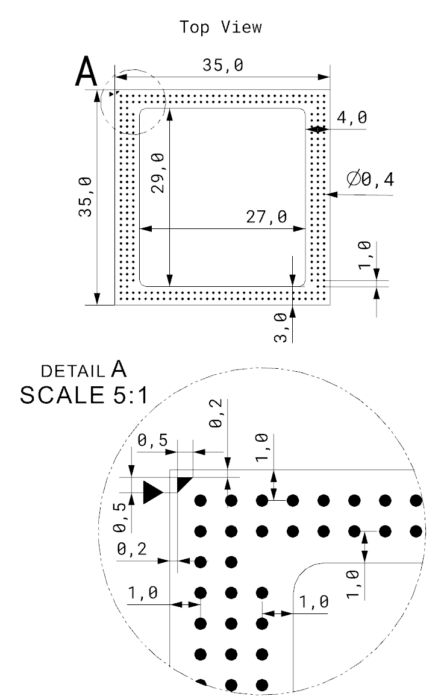
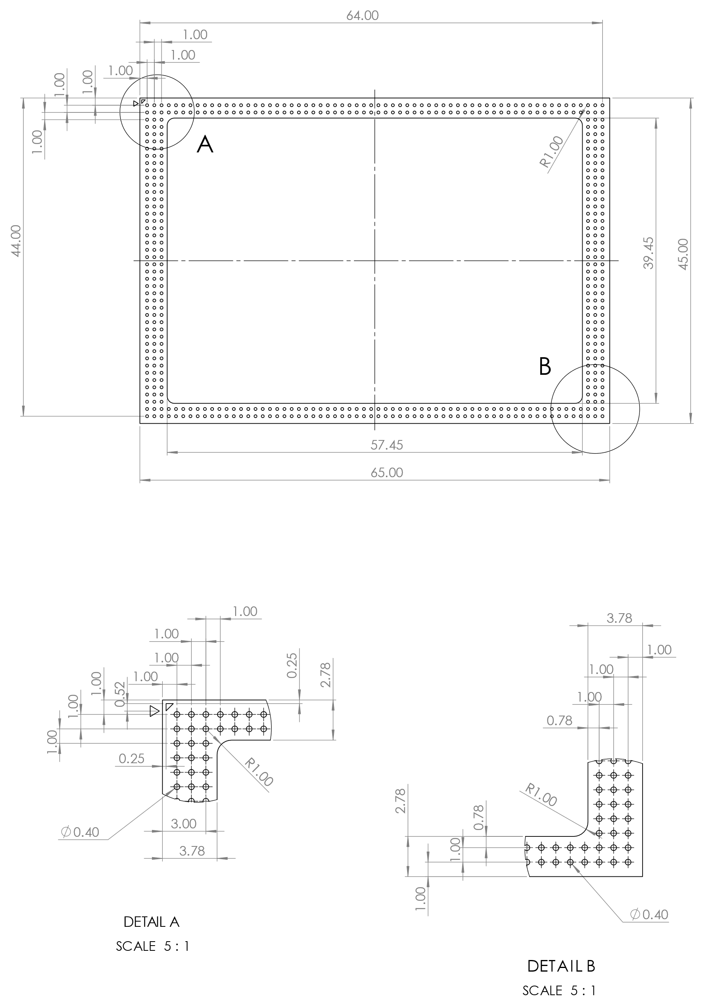
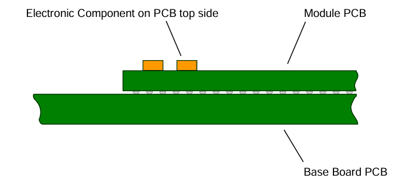
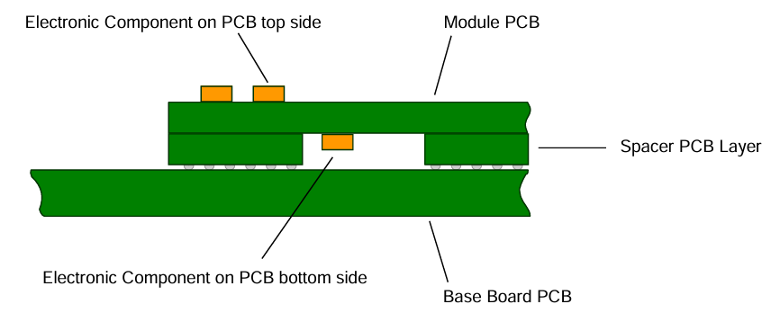
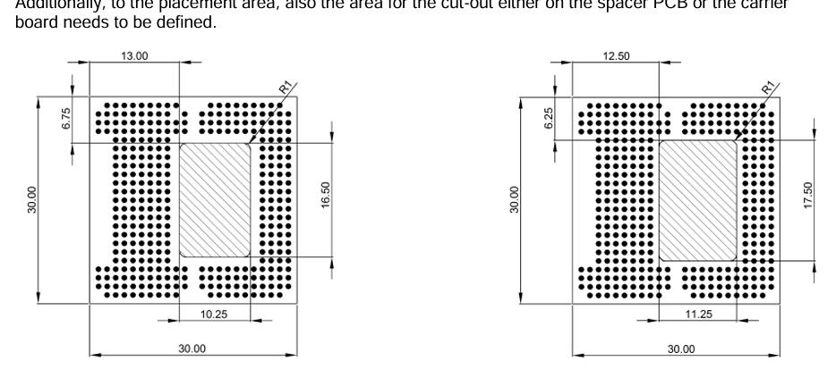

# E1M™ Specification — Edge-1 AI Module

**Designation:** E1M-STD-1.0
**Edition:** 1.0
**Revision:** 1.3
**Date:** 2026 _(release date pending)_
**Status:** Draft for review
**Publisher:** Alp Lab AB

**Reference implementation:** `pinout/v1.json` (E1M, 35 × 35 mm) and
`pinout/x-v1.json` (E1M-X, 45 × 65 mm) in this repository, validated by
`pinout/schema/loom-v1.schema.json`.

---

## Foreword

This specification is published by Alp Lab AB as an open standard for
small-form-factor, AI-capable, machine-processable Module-on-Module
(MoM) products. It is part of the **Open Standard Module™** family of
specifications.

The standard fixes the carrier-board pinout, mechanical envelope, and
electrical interface of two module form factors — **E1M** (35 × 35 mm)
and **E1M-X** (45 × 65 mm) — so that a single carrier board can host
modules built around different MCU, MPU, AI-accelerator, and memory
silicon, provided each module conforms to this specification.

Per-SoM design files (schematics, PCB layout, manufacturing data,
firmware) are **not** part of this specification. Each conformant SoM
publishes a per-SoM manifest declaring the routed subset of E1M pads
and the silicon behind those pads (see Annex C).

The pinout JSON files in this repository are mechanically generated
from the Altium pin-list exports kept under `source/`. The CI workflow
re-runs the generator on every push and rejects any commit that drifts
from the source.

This document is Edition 1.0, document revision 1.3, a draft for
review; revision 1.2 is the current release and revision 1.0 was the
first public release. Subsequent revisions follow the versioning rules
in §1.5.

---

## Introduction

E1M defines the universe of physical pads on a 35 × 35 mm or 45 × 65 mm
LGA SoM and which peripheral signals each pad may carry. The standard
is intentionally **silicon-agnostic**: it specifies pad-to-signal
assignments at the **default-function** level, and adds **GPIO** as a
universal secondary on every digital pad. Anything beyond the default
plus GPIO secondary — such as silicon-specific alternate functions — is
declared by the per-SoM manifest and falls outside E1M conformance.

The two form factors share the same family of signal classes; E1M-X
adds higher pad density to expose additional controllers (more PCIe
ports, more MIPI CSI lanes, parallel LCD, etc.) than fits on E1M.

---

## 1 Scope

### 1.1 What this specification covers

This specification defines, for the E1M and E1M-X form factors:

- The mechanical envelope (outline, height, component placement areas).
- The electrical interface (power input, voltage rails, reset, boot
  strap, electrical characteristics).
- The complete pinout (every pad's coordinate, default function, and
  the signal classes it may carry under the alternative-function
  policy in §8).
- The conformance criteria for SoMs and carrier boards (§9).
- The pinout JSON format (Loom v1) used to consume the standard
  programmatically (Annex B).

### 1.2 What this specification does not cover

- The internal design of any SoM (silicon, supporting components,
  software). These are SoM-vendor-specific and live outside this
  repository.
- Per-SoM peripheral mappings beyond the default and GPIO secondary
  functions. These live in per-SoM manifests (Annex C).
- Carrier-board reference designs.
- Marketing claims or feature endorsements.

### 1.3 Audience

- **SoM designers** producing E1M-conformant modules.
- **Carrier-board designers** producing baseboards, breakout boards,
  or end products that mount an E1M SoM.
- **Tooling authors** producing EDA libraries, schematic generators,
  or build systems that consume the pinout JSON.

### 1.4 Conventions

The keywords **MUST**, **MUST NOT**, **REQUIRED**, **SHALL**, **SHALL
NOT**, **SHOULD**, **SHOULD NOT**, **RECOMMENDED**, **MAY**, and
**OPTIONAL** in this document are to be interpreted as described in
[RFC 2119].

Throughout this document:

- Pad identifiers (e.g. `A1`, `K63`, `AQ15`) follow the BGA-style
  convention: column letter(s) followed by row number, in the
  coordinate space of the named form factor.
- Pin names in monospace (e.g. `I2C0_SCL`) match the `silkscreen`
  field of the corresponding pad in the pinout JSON.
- A value of *TBD* indicates a parameter intentionally not yet
  specified in this revision.

### 1.5 Versioning

The form-factor uses `major.minor` versioning:

- A **major** bump is required for any backwards-incompatible pad
  change — for example, removing a pad, narrowing the SignalKind set
  a pad may carry, or shifting a pad's coordinate.
- A **minor** bump is permitted for additions only — for example,
  populating a previously-reserved pad or adding an alt-function entry
  to an existing pad.

Released editions are tagged `v<major>.<minor>` in this repository
(e.g. `v1.0`).

---

## 2 Normative references

The following documents are referenced normatively. Where a dated
reference is given, only that revision applies. Where an undated
reference is given, the latest revision (including any amendments)
applies.

| Reference | Title |
| --- | --- |
| RFC 2119 | _Key words for use in RFCs to Indicate Requirement Levels_, S. Bradner, March 1997. |
| Loom format v1 | `pinout/schema/loom-v1.schema.json` in this repository. |

---

## 3 Terms, definitions, and abbreviations

### 3.1 Terms and definitions

- **carrier board** — Host PCB that mates with an E1M SoM via the LGA
  pad pattern defined in §5 and §7.
- **conformant** — Satisfying every **SHALL** clause in §9 for the
  applicable role (SoM or carrier board).
- **default function** — The single primary signal that an E1M pad
  **SHALL** carry on every conformant SoM that exposes that pad.
  Recorded in the `default` field of the pad's JSON entry and in the
  *Pin name* column of §7.3.
- **form factor** — One of the two mechanical envelopes defined in §4.
- **module / SoM (System-on-Module)** — Self-contained compute LGA
  module conforming to this specification.
- **pad** — Physical contact on the SoM's LGA package, identified by
  a BGA-style coordinate.
- **per-SoM manifest** — A separate, vendor-supplied document that
  declares which E1M pads a particular SoM routes and the silicon
  behind them (Annex C).

### 3.2 Abbreviations

| Term | Meaning |
| --- | --- |
| ADC | Analogue-to-digital converter |
| BGA | Ball-grid array (used here for the pad-numbering convention) |
| CAN | Controller area network |
| CSI | (MIPI) Camera Serial Interface |
| DAC | Digital-to-analogue converter |
| DBG | Debug-console UART |
| DSI | (MIPI) Display Serial Interface |
| ENC | Quadrature encoder |
| GPIO | General-purpose input / output |
| I²C, I³C | Inter-integrated circuit, version 2 / version 3 |
| I²S | Inter-IC sound |
| JTAG | Joint Test Action Group test interface |
| LCD | Liquid-crystal display (parallel RGB) |
| LGA | Land-grid array |
| LDO | Low-dropout regulator |
| MoM | Module-on-Module |
| NC | Not connected |
| OSM | Open Standard Module™ |
| PCIe | Peripheral Component Interconnect Express |
| PDM | Pulse-density modulation (microphone) |
| PMIC | Power-management IC |
| PWM | Pulse-width modulation |
| RSVD | Reserved for future use |
| SDIO | Secure-digital input/output |
| SoM | System-on-Module |
| SPI | Serial peripheral interface |
| SWD | (ARM) Serial-wire debug |
| TPM | Trusted Platform Module |
| UART | Universal asynchronous receiver-transmitter |
| WS | Word select (I²S frame strobe) |

---

## 4 Form factors

### 4.1 E1M ("Normal")

| Attribute | Value |
| --- | --- |
| Outline | **35 × 35 mm**, ±0.1 mm (TBD) |
| Pad pattern | LGA |
| Pad count | **312** |
| Coordinate space | Columns `A`–`AH`, rows `1`–`34` |
| Reference SoMs | E1M-AEN family — six SKUs `E1M-AEN301`/`401`/`501`/`601`/`701`/`801` (Alif Semiconductor Ensemble E3–E8). |

### 4.2 E1M-X ("Extended")

| Attribute | Value |
| --- | --- |
| Outline | **45 × 65 mm**, ±0.1 mm (TBD) |
| Pad pattern | LGA |
| Pad count | **496** |
| Coordinate space | Columns `A`–`AR`, rows `1`–`64` |
| Reference SoMs | E1M-X V2N family — `E1M-V2N101`/`E1M-V2N102`. E1M-X V2N-M1 family — `E1M-V2M101`/`E1M-V2M102` (Renesas RZ/V2N + DRP-AI3 + optional DeepX M1). |

### 4.3 Coordinate system

Each form factor uses an **independent** coordinate space. Pad `A1` on
E1M is **not** the same physical position as pad `A1` on E1M-X. SoM
manifests reference pads by `(form-factor id, coordinate)`. The
form-factor identifier `E1M` or `E1M-X` is recorded in the top-level
`id` field of the corresponding pinout JSON.

---

## 5 Mechanical requirements

### 5.1 Footprint

#### 5.1.1 E1M (35 × 35 mm)



*Figure 1 — E1M footprint (top view). Overall envelope 35.0 × 35.0 mm.
Central cavity 29.0 × 27.0 mm. Detail A (5:1 scale) shows the corner
pad band: 1.0 mm pad pitch (signal grid), 0.40 mm pad diameter. Pin
A1 corner is marked by the 0.5 mm triangular fiducial.*

The E1M signal pads **SHALL** lie on a 1.0 mm pitch grid and **SHALL**
be 0.40 mm diameter round copper pads. _Informative — carrier land
pattern published for E1M-AEN (DS-AEN-001; values confirmed by E1M-AEN
only): IPC-7351 nominal density, round non-solder-mask-defined (NSMD)
pads 0.40 mm diameter, solder-mask opening 0.50 mm diameter, stencil
aperture 1:1 (0.40 mm diameter), stencil thickness 0.08 mm._

> **TODO (Alp Lab):** publish the full normative dimension callouts —
> tolerances on every dimension shown, solder-mask opening size, paste
> aperture, recommended carrier-board land pattern (per IPC-7351), and
> the matching Altium libraries.
> **Source:** Altium project (mechanical layers + footprint library).
> **Format:** Annex to this specification + an `altium/` directory in
> this repository containing the open-source footprint library.

#### 5.1.2 E1M-X (45 × 65 mm)



*Figure 2 — E1M-X footprint (top view). Overall envelope 45.0 × 65.0 mm.
Central cavity 39.45 × 57.45 mm. Two corner Detail views (5:1 scale)
show the pad band on the long and short edges. A scalable vector copy
is available in `images/e1m-x-footprint.svg`.*

> **TODO (Alp Lab):** publish the full normative dimension callouts and
> Altium library, as for §5.1.1.

### 5.2 Module height

Two height classes are defined. A SoM **SHALL** declare its height
class in its per-SoM manifest.

#### 5.2.1 Standard height



*Figure 3 — Standard-height cross-section. The SoM PCB sits directly
on the base-board surface; only the SoM's top-side components rise
above the base-board plane.*

> **TODO (Alp Lab):** specify the maximum module thickness measured
> from the underside of the SoM PCB to the highest top-side component,
> including any EMI shield. Specify the recommended LGA pad height /
> stand-off.
> **Format:** dimensioned mechanical drawing + numeric envelope (e.g.
> "≤ 2.5 mm above base-board top surface, including shield").

#### 5.2.2 Extended height



*Figure 4 — Extended-height cross-section. A spacer-PCB layer between
the SoM and the base board allows components on the bottom side of
the SoM to clear the base-board surface.*

> **TODO (Alp Lab):** specify the spacer-PCB thickness, the maximum
> total module thickness measured from base-board top surface to the
> highest top-side component, the maximum component height on the
> SoM bottom side, and the recommended cut-out / cavity in the
> base-board PCB or spacer.

### 5.3 Component placement areas



*Figure 5 — Component placement areas (top side, left; bottom side,
right). The hatched centre rectangle denotes the maximum-component-zone
within the LGA pad band; coordinates **TBD**.*

Where present, EMI shielding **SHALL** fit within the declared height
envelope.

> **TODO (Alp Lab):** publish numeric keepout dimensions for top and
> bottom placement zones for each form factor, the recommended cut-out
> in the base-board PCB or spacer, and any vendor-defined keepout for
> RF / antenna routing.
> **Format:** dimensioned drawing + table mapping zone → max component
> height for each form factor and height class.

### 5.4 Soldering

E1M and E1M-X **SHALL** be solderable to the carrier board using
LGA-class reflow soldering. Where a particular SoM is also compatible
with BGA-class reflow profiles, the per-SoM manifest **MAY** declare
this.

> **TODO (Alp Lab):** publish a recommended reflow profile (peak
> temperature, time above liquidus, ramp rates), paste-stencil
> thickness and aperture geometry, and rework / desoldering guidelines.
> **Source:** SoM characterisation lab data.
> **Format:** time-temperature curve + numeric table per IPC J-STD-020
> and J-STD-001.

### 5.5 Packaging

> **TODO (Alp Lab):** specify tape-and-reel pocket geometry, reel
> diameter, units per reel, MSL (moisture-sensitivity level) rating,
> dry-pack and shelf-life requirements, and tray dimensions for the
> tray alternative.
> **Source:** SoM manufacturing partner.
> **Format:** EIA-481-compliant tape-and-reel drawing + JEDEC-compliant
> tray drawing.

---

## 6 Electrical requirements

### 6.1 Power architecture

Conformant SoMs **SHALL** generate every internal supply rail on board
from a single externally-supplied 5 V input on the `VDD_5V_IN` pads
(silkscreen `VDD` on E1M; see §7.3.1). On-module power management
**SHALL** be performed by an I²C-controlled PMIC.

A SoM **SHALL** expose a regulated 1.8 V I/O reference rail on the
`VIO_OUT` pads, sized to power any I/O level-shifting on the carrier
board (§6.1.2).

A SoM **SHALL** include all decoupling capacitors required for
correct on-module operation. Carrier-board designers **SHOULD** add
additional decoupling capacitors close to high-current loads on the
carrier side.

> **Value provenance.** Where a value in §6 is marked _(E1M-AEN
> only)_, it is confirmed by the E1M-AEN documentation (DS-AEN-001 /
> HG-AEN-001, hw_rev R3) and is still TBD in the E1M-X V2N and V2N-M1
> documentation. Where it is marked _(E1M-X V2N / V2N-M1 only)_, the
> reverse applies. Such values bind every SoM and every carrier until
> a later revision states otherwise.

#### 6.1.1 5 V supply input

The clauses below define the 5 V window for a carrier that hosts
**any** conformant SoM. The window is the strictest combination of the
windows of the reference SoMs (Annex A).

1. **Operating window.** The carrier **SHALL** hold the voltage at the
   `VDD_5V_IN` pads between **4.75 V and 5.25 V**, measured at the
   pads, at every load up to the peak input current the SoM declares.
2. **Absolute maximum.** The carrier **SHALL** keep the voltage at the
   `VDD_5V_IN` pads at or below **5.5 V** at all times, including
   transients, load release and hot-plug overshoot. A
   transient-voltage suppressor alone does not meet this clause,
   because the clamp voltage of a 5 V TVS is well above 5.5 V; an
   over-voltage cut-off or clamp (for example an eFuse or load switch
   with over-voltage protection) is needed ahead of the pads.
3. **Ramp.** The rise of `VDD_5V_IN` from 0 V to 4.75 V **SHALL** be
   monotonic and **SHALL** complete within **40 ms** _(E1M-AEN only)_.
4. **Pads.** The carrier **SHALL** connect every `VDD_5V_IN` pad (E1M:
   `R1`, `R2`, `S1`, `S2`; E1M-X: `T1`, `T2`, `U1`, `U2`, `V1`, `V2`)
   to the 5 V supply through a low-impedance path, and **SHALL NOT**
   connect any other supply to them.
5. **Current.** The carrier 5 V source **SHALL** be sized for the peak
   input current the SoM declares, not for its average current, plus
   every carrier load that shares the source.
6. **Input protection.** A SoM is not required to include input
   protection. The carrier **SHALL** provide the over-voltage
   protection that clause 2 needs and, where the 5 V input connector
   can be mis-wired, reverse-polarity protection.
7. **Hold-up capacitance.** The carrier **SHALL** place, next to the
   `VDD_5V_IN` pads, at least the bulk capacitance the SoM declares.
8. **Source OR-ing.** Where the carrier can feed `VDD_5V_IN` from more
   than one source, it **SHALL NOT** back-feed an inactive source (use
   a unidirectional eFuse or an ideal-diode controller). The voltage
   drop of the OR-ing element **SHALL** still leave at least 4.75 V at
   the pads (clause 1).
9. **SoM side.** A conformant SoM **SHALL** operate across
   4.75–5.25 V at its `VDD_5V_IN` pads, **SHALL** withstand 5.5 V
   without damage, and **SHALL** start correctly from any monotonic
   ramp that reaches 4.75 V within 40 ms _(ramp value: E1M-AEN only)_.
   The SoM **SHALL** declare in its manifest its operating range,
   absolute maximum, peak input current, on-module input capacitance
   and the minimum carrier bulk capacitance.

A carrier that declares (§8.4, §9.2) that it hosts only SoMs whose
manifests declare a wider window **MAY** use that wider window.

*5 V input values of the reference SoMs (informative):*

| Parameter | E1M-AEN (DS-AEN-001, hw_rev R3) | E1M-X V2N / V2N-M1 (DS-V2N-001, DS-V2N-M1-001) |
| --- | --- | --- |
| Operating range (min / typ / max) | 4.75 / 5.0 / 5.25 V | 4.5 / 5.0 / 5.5 V (the HG documents recommend ±5 %) |
| Absolute maximum | 5.5 V | 6.0 V |
| Ramp | monotonic, 0 V to 4.75 V within 40 ms | not specified |
| Peak input current | 834 mA (`E1M-AEN801`, calculated) | TBD; carrier 5 V source ≥ 5 A peak recommended |
| On-module input capacitance | about 50 µF | not specified |
| Carrier bulk capacitance | ≥ 50 µF effective per A of total `VDD_5V_IN` load | ≥ 10 µF + 100 nF |

#### 6.1.2 VIO_OUT

1. **Level.** `VIO_OUT` **SHALL** be 1.8 V nominal, with a tolerance
   of ±5 % _(tolerance: E1M-X V2N / V2N-M1 only; E1M-AEN TBD)_. No
   other `VIO_OUT` level is defined in this revision.
2. **Direction.** `VIO_OUT` is a SoM output. The carrier **SHALL NOT**
   drive `VIO_OUT`, connect it to any other rail, or connect any source
   that can raise it above the SoM's own level.
3. **Permitted uses.** The carrier **SHALL** use `VIO_OUT` only (a) as
   the SoM-side supply or reference (V_CCA / V_REF) of carrier level
   translators and as the pull-up rail for signals into the SoM's
   1.8 V pads, (b) as a module-on indication, or (c) as the enable
   input of a carrier load switch that generates a carrier 1.8 V rail
   that follows the SoM. Any other carrier load that must follow the
   SoM **SHALL** be supplied from such a switched rail (use c).
4. **Load limits.** The SoM **SHALL** declare in its manifest the
   maximum load current and the maximum external capacitance on
   `VIO_OUT`. A carrier that hosts any SoM **SHALL** keep the total
   `VIO_OUT` load at or below **100 mA**, **SHALL** draw no more than
   **50 mA** during the first 2 ms after `VIO_OUT` rises, and **SHALL**
   keep the total capacitance on `VIO_OUT` at or below **2.5 µF**
   _(E1M-AEN only; E1M-X V2N / V2N-M1: TBD)_. Excess capacitance can
   stop the SoM's 1.8 V rail from starting.
5. **Translator power-off behaviour.** Every level translator
   referenced to `VIO_OUT` **SHALL** keep both of its ports
   high-impedance while its `VIO_OUT`-side supply is off (I_off or
   partial-power-down specified). Some pass-gate translators conduct
   with V_CCA at 0 V and do not meet this clause.
6. **Sensing.** A carrier that monitors `VIO_OUT` **SHALL** do so
   through a high-impedance input whose own supply is on whenever the
   SoM can be powered, so that the monitor cannot back-power an
   unpowered host.

> **Forward compatibility (informative).** `VIO_OUT` is 1.8 V in this
> revision, and carriers treat it as 1.8 V. Carrier designers are
> recommended to choose level translators whose `VIO_OUT`-side supply
> (V_CCA) is rated 1.65–3.6 V, so that the same carrier part still
> works if a later revision defines another `VIO_OUT` level. This
> recommendation does not define a 3.3 V `VIO_OUT` class.

### 6.2 Power sequencing

The SoM **SHALL** sequence all of its internal rails itself. A carrier
**SHALL NOT** be required to sequence any supply; the carrier orders
only the control pads (§6.3) and the signal pads.

#### 6.2.1 Power-up

1. **First,** the carrier applies `VDD_5V_IN` within the limits of
   §6.1.1. To keep the SoM off, the carrier holds `MODULE_EN` low
   before and while `VDD_5V_IN` rises; otherwise it leaves
   `MODULE_EN` released.
2. **Then** the carrier waits until `VIO_OUT` is high and `PORn` is
   high.
3. **Only then** the carrier **MAY** drive the signal pads of the SoM
   (§6.2.3).

A SoM **SHALL** declare in its manifest the maximum time from
`VDD_5V_IN` reaching 4.75 V, or from `MODULE_EN` release, to `PORn`
high. Where `VIO_OUT` and `PORn` high do not yet mean that the SoM can
receive signals, the SoM **SHALL** declare the additional delay and
the carrier **SHALL** wait for it. _Informative: E1M-AEN releases
`PORn` 206 ms typical, 290 ms maximum after `VDD_5V_IN` reaches
4.75 V or `MODULE_EN` is released (DS-AEN-001). E1M-X V2N / V2N-M1
have no ready output; the hand-off delay is TBD._

#### 6.2.2 Power-down

1. **First,** the carrier **SHOULD** request a graceful shut-down by
   the means the SoM manifest declares (application link, a GPIO, or
   `MODULE_STBY`) and give the SoM time to finish writes to
   non-volatile memory.
2. **Next,** when `PORn` falls, the carrier **SHALL** set every output
   that drives a SoM signal pad to high impedance or low within
   **1 ms** _(E1M-AEN only)_.
3. **Then,** if the SoM has not powered off by itself, the carrier
   forces power-off with `MODULE_EN` low (§6.3.1).
4. **Last,** the carrier removes `VDD_5V_IN`. It **SHOULD** wait until
   `VIO_OUT` is low before it removes `VDD_5V_IN`.

> **Data loss.** Pulling `MODULE_EN` low, pulling `PORn` low and
> removing `VDD_5V_IN` give the SoM firmware no notice. Writes to
> on-module non-volatile memory that are in progress at that moment
> are lost or corrupted.

#### 6.2.3 Back-powering and I/O gating

1. **No drive into an unpowered SoM.** While `VIO_OUT` is low, the
   carrier **SHALL NOT** drive any `VIO_OUT`-domain signal pad
   (§6.7.1) high and **SHALL NOT** source current into it, whether
   from a push-pull output, a pull-up resistor, a debug probe, a
   USB-to-UART bridge or any other carrier circuit. Pull-down
   resistors, and open-drain outputs that only pull low, are permitted
   at any time.
2. **Exceptions.** Clause 1 does not apply to `MODULE_EN` (5 V
   tolerant, §6.3.1), to `IO25` when the SoM uses it as `RTC_WAKE_N`
   (open-drain, 5 V tolerant, §8.2), or to pads in a domain other
   than `VIO_OUT`; those pads follow the rule in §6.7.1. Clause 4
   does not apply to `RTC_WAKE_N` either: its pull-up goes to an
   always-on rail.
3. **Gate.** The carrier **SHALL** use `VIO_OUT` high together with
   `PORn` high as the condition for driving `VIO_OUT`-domain signal
   pads (§6.2.1 and §6.2.2).
4. **Pull-up rail.** Every carrier pull-up on a `VIO_OUT`-domain pad
   **SHALL** go to `VIO_OUT` or to a carrier rail switched by
   `VIO_OUT` (§6.1.2 clause 3), never to an always-on rail.
5. **Level.** The carrier **SHALL** keep every `VIO_OUT`-domain pad
   between −0.3 V and 1.98 V (absolute maximum of the 1.8 V pads of
   both E1M-AEN and E1M-X V2N / V2N-M1).
6. **Debug probes.** A debug probe or console adapter on the SoM's
   debug pads (§7.3.10, §7.3.13) **SHALL** use `VIO_OUT` as its target
   reference, **SHALL** have its target-power output disabled, and
   **SHALL** keep its outputs high-impedance while `VIO_OUT` is low.
7. **Switched pad groups.** Where a SoM supplies a group of its
   `VIO_OUT`-domain pads from an internal rail that can be off while
   `VIO_OUT` is high (for example the pads of an on-module radio), it
   **SHALL** list those pads in its manifest, and the carrier
   **SHALL** apply clause 1 to them while that rail is off.

### 6.3 Reset and module enable

| Pad | Direction | Polarity | Description |
| --- | --- | --- | --- |
| `MODULE_EN` | input | active-high (default high via SoM-internal pull-up) | Drive low to switch the SoM off and hold it off; release to switch it on. 5 V tolerant. Open-drain drive. Carrier **MAY** leave floating if not used. Drive rules: §6.3.1. |
| `MODULE_STBY` | input | active-low (default high via SoM-internal pull-up) | Module standby (low-power) request. The protocol (level or pulse) is declared in the per-SoM manifest. Not 5 V tolerant on every SoM. Open-drain drive. Carrier **MAY** leave floating if not used. Drive rules: §6.3.1. |
| `PORn` | input, open-drain, wired-AND | active-low (default high via SoM-internal pull-up to 1.8 V) | Power-on reset. Drive low to reset the SoM. A SoM **MAY** also hold it low itself while its rails are not valid. Carrier **MAY** leave floating if not used. Drive rules: §6.3.1. |

A SoM **SHALL** power up and boot when `VDD_5V_IN` is applied with
`MODULE_EN`, `MODULE_STBY` and `PORn` all left unconnected. None of
these pads needs a carrier pull-up.

#### 6.3.1 Control-pad drive rules

1. **MODULE_EN.** A SoM **SHALL** tolerate any voltage from −0.3 V to
   5.5 V on `MODULE_EN` and **MAY** pull it up internally to a rail as
   high as `VDD_5V_IN`. The carrier **SHALL** pull `MODULE_EN` low
   only with an open-drain or open-collector output, a switch or a
   push-button to `GND`; push-pull drive is permitted only towards
   SoMs whose manifest allows it. The carrier **SHALL NOT** fit a
   pull-up on `MODULE_EN` to a rail that can be off while `VDD_5V_IN`
   is present, and **SHALL NOT** connect `MODULE_EN` directly to a GPIO
   of a host that can be unpowered while the SoM must stay on (the
   unpowered host clamps the line low); such a host **SHALL** drive
   `MODULE_EN` through a buffer, for example an N-MOSFET to `GND`.
   Every carrier part on `MODULE_EN` (buffer transistor, ESD diode,
   read-back input) **SHALL** be rated for 5.5 V. With the carrier
   driver released, the total carrier leakage on `MODULE_EN` **SHALL
   NOT** exceed 0.1 µA _(E1M-AEN only; its internal pull-up is about
   1 MΩ)_. `MODULE_EN` low is a hard power cut and **SHOULD NOT** be
   used as the normal power-off path (§6.2.2).
2. **MODULE_STBY.** The carrier **SHALL** pull `MODULE_STBY` low only
   with an open-drain output, a switch or a push-button to `GND`, and
   **SHALL NOT** fit a pull-up on it to any rail other than `VIO_OUT`.
   With the carrier driver released, the total carrier leakage on
   `MODULE_STBY` **SHALL NOT** exceed 0.1 µA _(E1M-AEN only)_. A SoM
   **SHALL** declare in its manifest the standby protocol (level or
   pulse) and the minimum low and high times.
3. **PORn.** The carrier **SHALL** pull `PORn` low only with an
   open-drain output, a switch or a push-button to `GND`, **SHALL NOT**
   drive it high, and **SHALL NOT** fit a pull-up on it. The carrier
   **SHALL** hold `PORn` low for at least the minimum the SoM declares,
   and for at least 2 ms when it targets any SoM _(E1M-AEN only;
   E1M-X V2N / V2N-M1: TBD)_. The carrier **SHALL NOT** add more than
   1 nF on `PORn` _(E1M-AEN only)_. A carrier input that reads `PORn`
   **SHALL** be high-impedance while its own supply is off.
4. **JTAG_nRST.** The carrier **SHALL** pull `JTAG_nRST` low only with
   an open-drain output and **SHALL NOT** fit a pull-up on it to any
   rail other than `VIO_OUT`.

### 6.4 Boot configuration

E1M and E1M-X define a four-pin boot strap on `BOOT0`, `BOOT1`,
`BOOT2`, and `BOOT3`.

1. **Pads.** A conformant SoM **SHALL** expose `BOOT0`–`BOOT3` on its
   footprint at the pad locations of §7.3.1 and **SHALL NOT** assign
   any other function to those pads.
2. **Interpretation.** The interpretation of the strap is
   silicon-specific and **SHALL** be declared in the per-SoM manifest.
3. **Ignored strap.** A SoM whose boot does not depend on the strap
   **MAY** ignore `BOOT0`–`BOOT3` (for example, leave the pads
   unconnected on the module). Such a SoM **SHALL** declare in its
   manifest that it ignores the strap, and **SHALL** tolerate any
   carrier strap circuit that meets clause 4.
4. **Carrier.** A carrier board **MAY** fit a strap circuit on
   `BOOT0`–`BOOT3` whatever SoM it targets. Its pull-ups **SHALL** go
   to `VIO_OUT` or to a carrier rail switched by `VIO_OUT` (§6.2.3).
   On a SoM that declares the strap ignored, the circuit has no
   effect, so a carrier that hosts several SoMs keeps the same strap
   circuit for all of them.

_Informative: E1M-AEN leaves `BOOT0`–`BOOT3` unconnected on the
module, boots from on-chip MRAM and declares the strap ignored
(Annex A.1); it is conformant to this clause._

The reference mapping below applies to the rev 1.0 reference SoMs
based on Renesas RZ/V2N (informative).

| BOOT1 | BOOT0 | Boot mode | Device | CA55 boot | CM33 boot |
| :---: | :---: | --- | --- | :---: | :---: |
| 0 | 0 | Mode 0 | eSD (3.3 V) | Supported | Not supported |
| 0 | 1 | Mode 1 | eMMC (1.8 V I/O) | Supported | Not supported |
| 1 | 0 | Mode 2 | QSPI NOR (1.8 V I/O) | Supported | Supported |
| 1 | 1 | Mode 3 | SCIF download | Supported | Supported |

`BOOT2` is fixed at `1` on the rev 1.0 reference SoMs; carrier boards
**SHALL** drive it according to the SoM manifest's declared default
or leave it as the SoM's internal pull defines. `BOOT3` selects the
boot CPU on the reference SoMs (high → CA55, low → CM33).

> **TODO (Alp Lab):** define the **normative** strap interpretation
> independent of any specific silicon. Either:
>
> - (a) Specify the meaning of every (`BOOT0`, `BOOT1`, `BOOT2`,
>   `BOOT3`) tuple at the standard level (e.g. `00xx` = boot from
>   eMMC, `01xx` = boot from QSPI, etc.) and require all conformant
>   SoMs to honour it; or
> - (b) Promote the strap to a per-SoM manifest field entirely and
>   delete the silicon-specific table above from §6.4.
>
> The current text describes a Renesas RZ/V2N mapping in a
> nominally-vendor-agnostic standard, which violates the §1.2
> "no-per-SoM-data" rule.

### 6.5 Mandatory on-module components

The E1M pinout is designed around a SoM that integrates the
following functions **on the module itself**, so that carrier-board
designers do not have to repeat them:

| Component | Requirement |
| --- | --- |
| **Ethernet PHY(s)** | A conformant SoM **SHALL** include at least one on-module Ethernet PHY connected to the SoC's MAC and exposed on the carrier board via the PHY-side (pre-magnetics) differential MDI pads (`ETH0_*` minimum). SoMs whose SoC supports two MACs **SHALL** populate a second on-module PHY and expose `ETH1_*`. The SoM **SHALL** declare in its manifest the highest link rate of each port (§7.3.6). |
| **Wi-Fi + Bluetooth combo** | A conformant SoM **SHALL** include an on-module Wi-Fi 6 (IEEE 802.11ax) and Bluetooth 5.4 combo radio. 2.4 GHz operation is **REQUIRED**. 5 GHz operation and 6 GHz operation are each **OPTIONAL**; the SoM **SHALL** declare in its manifest the Wi-Fi bands it supports. |
| **Antenna outputs** | The SoM **SHALL** drive `ANT_2.4GHz` (§7.3.2). It **SHALL** drive `ANT_5GHz` and `ANT_6GHz` only for a band it supports and uses on that pad. A SoM that does not use `ANT_5GHz` or `ANT_6GHz` **SHALL** leave that pad no-connect on the module and **SHALL** declare it in its manifest. _Informative: E1M-AEN (2.4 GHz only) drives `ANT_2.4GHZ` and leaves `ANT_5GHZ` and `ANT_6GHZ` no-connect; it is conformant._ |
| **CAN transceiver(s)** | If the SoM exposes the CAN pads of a CAN group (§7.3.14), it **SHALL** implement that group in one of two options and **SHALL** declare the option for each group in its manifest. **Bus-level CAN** (the default): the SoM includes an on-module CAN transceiver, and the pads carry the bus side (`CANxH`, `CANxL`), suitable for direct connection to a terminator and a CAN connector. **Logic-level CAN** (declared option): the SoM has no on-module transceiver for that group, the pads carry the controller side (`CANx_TX`, `CANx_RX`) in the `VIO_OUT` (1.8 V) domain, and the carrier provides the transceiver (§7.3.14). |

Carrier-board designers **SHALL NOT** add an external Ethernet PHY,
Wi-Fi/BLE module, or CAN transceiver between the carrier and any of
these signal classes; the carrier provides only the magnetics + RJ-45
(for Ethernet), antenna routing or external antenna connector (for
Wi-Fi / BLE), and bus termination + connector (for CAN). The one
exception is a CAN group that the SoM declares as logic-level CAN: for
that group the carrier **SHALL** provide the transceiver (§7.3.14).

This is a **family-wide** invariant: it applies to every conformant
E1M and E1M-X SoM regardless of which SoC silicon the SoM uses.

### 6.6 Electrical characteristics

The values below are fixed by this revision; each row points to the
clause that makes it normative.

| Parameter | Value | Clause |
| --- | --- | --- |
| `VDD_5V_IN` operating window at the pads | 4.75–5.25 V | §6.1.1 (1), (9) |
| `VDD_5V_IN` absolute maximum (carrier limit; SoM withstand) | 5.5 V | §6.1.1 (2), (9) |
| `VDD_5V_IN` ramp, 0 V to 4.75 V | monotonic, ≤ 40 ms _(E1M-AEN only)_ | §6.1.1 (3), (9) |
| `VIO_OUT` level | 1.8 V nominal, ±5 % _(tolerance: E1M-X V2N / V2N-M1 only)_ | §6.1.2 (1) |
| `VIO_OUT` carrier load, any SoM | ≤ 100 mA; ≤ 50 mA in the first 2 ms; ≤ 2.5 µF _(E1M-AEN only)_ | §6.1.2 (4) |
| `VIO_OUT`-domain signal pads | −0.3 V to 1.98 V | §6.2.3 (5) |
| Carrier outputs Hi-Z or low after `PORn` falls | ≤ 1 ms _(E1M-AEN only)_ | §6.2.2 (2) |
| `MODULE_EN` voltage range the SoM tolerates | −0.3 V to 5.5 V | §6.3.1 (1) |
| `MODULE_EN`, `MODULE_STBY` released carrier leakage | ≤ 0.1 µA _(E1M-AEN only)_ | §6.3.1 (1), (2) |
| `PORn` carrier low pulse, any SoM | ≥ 2 ms _(E1M-AEN only)_ | §6.3.1 (3) |
| `PORn` carrier capacitance | ≤ 1 nF _(E1M-AEN only)_ | §6.3.1 (3) |

> **TODO (Alp Lab):** publish the remaining characteristics as four
> tables, each indexed by signal class:
>
> 1. **Absolute maximum ratings** — all signal pads not covered above,
>    ESD per HBM/CDM, junction temperature.
> 2. **Recommended operating conditions** — operating temperature
>    range, humidity range.
> 3. **DC characteristics** — `V_IH`, `V_IL`, `V_OH`, `V_OL`, leakage,
>    pull-up / pull-down resistance, per pad class.
> 4. **AC characteristics** — slew rate, output drive strength, and
>    interface-specific timing (USB, MIPI, PCIe, etc.) where the
>    standard imposes timing beyond what the underlying interface
>    spec already mandates.
>
> Also confirm the values marked _(E1M-AEN only)_ for E1M-X V2N /
> V2N-M1, and the E1M-X V2N / V2N-M1 power-up hand-off delay (§6.2.1).
> **Source:** SoM characterisation lab data, derived from the silicon
> datasheets of conformant SoMs and validated on the SoM PCB.

### 6.7 Pad voltage domains and safe default fits

#### 6.7.1 Pad voltage domains

Unless listed below, every signal pad of a conformant SoM is in the
`VIO_OUT` (1.8 V) domain, and §6.2.3 applies to it. The pads below are
in another domain. The carrier **SHALL NOT** clamp them to `VIO_OUT`,
pull them up to `VIO_OUT` or level-translate them as 1.8 V signals,
and **SHALL** apply the rule given for each.

| Pads | Domain | Carrier rule |
| --- | --- | --- |
| `MODULE_EN` | up to 5.5 V | §6.3.1 (1). |
| `VDD_5V_IN` / `VDD` | 5 V input | §6.1.1. |
| `VIO_OUT`, `SD_VDD_OUT` / `SD_VDD`, `+V_CAM0`–`+V_CAM3` | SoM supply outputs | The carrier **SHALL NOT** drive, back-feed or connect another supply to them. _Informative: on E1M-AEN, `SD_VDD` was a carrier input on hw_rev R2 and is a 3.4 V SoM output from hw_rev R3._ |
| `SD_CLK`, `SD_CMD`, `SD_D0`–`SD_D3` | `SD_VDD_OUT` / `SD_VDD` | The carrier **SHALL** drive or pull them up only to `SD_VDD_OUT` / `SD_VDD` levels and only while that rail is on. _Informative: E1M-AEN 3.4 V through an on-module translator; E1M-X V2N / V2N-M1 1.8 V / 3.3 V, switched automatically._ |
| `BL_LED_A`, `BL_LED_K` | backlight LED string | The carrier **SHALL** connect only an LED string (anode on `BL_LED_A`) and its feedback network; it **SHALL NOT** connect a logic input or another supply. _Informative: E1M-AEN `BL_LED_A` reaches up to 36 V (KTD2801 over-voltage limit)._ |
| `ETH0_*`, `ETH1_*` MDI pairs | PHY MDI | §7.3.6. |
| `ANT_*` | RF | §7.3.2. |
| `USB*` data, `USB*_VBUS`, `USB_CC1`, `USB_CC2` | USB | Per the USB specifications. |
| `CSI*`, `DSI*`, `PCIE*` | high-speed differential | Per the MIPI and PCIe specifications. |
| `CANxH/CANx_TX`, `CANxL/CANx_RX` | bus level, or `VIO_OUT` domain, per the declared CAN option | §6.7.2 and §7.3.14. |
| `+S_CAP` | RTC backup store | As declared in the per-SoM manifest. |

A SoM **SHALL** declare in its manifest any other pad that is not in
the `VIO_OUT` domain, with its domain.

#### 6.7.2 Safe default fits for dual-meaning pads

The CAN pads (§7.3.14) carry either bus-level signals or 1.8 V logic
signals, depending on the CAN option the SoM declares. A carrier that
supports both options on one PCB uses assembly options (BOM variants,
0 Ω links or not-fitted parts).

1. **Safe default.** For every group of dual-meaning pads, the
   carrier's default assembly (the fit used when no SoM set is
   declared) **SHALL** be the fit that cannot damage any conformant
   SoM.
2. **CAN default.** For the CAN pads, the default assembly **SHALL** be
   the carrier-transceiver path: the carrier transceiver connected to
   the CAN pads, and the bypass path that connects the CAN pads
   straight to the bus connector, termination or bus-side protection
   not fitted (DNP). Bus voltages on logic-level CAN pads destroy the
   SoC: on the E1M-AEN standard build these are 1.8 V SoC pads with an
   absolute maximum of −0.3 V to 1.98 V.
3. **Bypass fit.** The carrier **MAY** fit the bypass path, with the
   carrier transceiver out of circuit, only in a build variant that
   declares (§9.2) a SoM set in which every SoM declares bus-level CAN
   for the CAN groups concerned. With a bus-level SoM on the default
   assembly, CAN does not work until the bypass variant is fitted.
4. **Mutual exclusion.** The carrier-transceiver path and the bypass
   path of the same CAN group **SHALL NOT** both be fitted.
5. **Declaration.** Every carrier build variant **SHALL** declare which
   fit it uses for each dual-meaning pad group and which SoMs it
   supports.

---

## 7 Pinout

### 7.1 Pin numbering convention

Pads on each form factor **SHALL** be identified using a BGA-style
coordinate of the form `<column-letter(s)><row-number>`:

- `A1` is the corner pad at column A, row 1, of the form factor's
  coordinate space.
- Letter columns increase as `A, B, …, Z, AA, AB, …, AH` for E1M and
  `A, B, …, Z, AA, AB, …, AR` for E1M-X.
- Row numbers increase from the top edge.

Each form factor uses its **own** coordinate space; the same physical
pad position has different coordinates on E1M and E1M-X. The
form-factor identifier `E1M` or `E1M-X` distinguishes the two.

The pad maps for both form factors are shown in Figures 6 and 7.


*Figure 6 — E1M pad map, top view. Columns A–AH (34 letters) × rows
1–34. Three-row peripheral pad band; centre is reserved for top-side
components per §5.3.*


*Figure 7 — E1M-X pad map, top view. Columns A–AR (44 letters) × rows
1–64. Three-row peripheral pad band on the long edges; full pad band
on the short edges to expose the additional CSI/PCIe controllers.*

### 7.2 Interface count overview

The following table summarises the count of each peripheral interface
exposed by this standard on each form factor.

| Feature | E1M | E1M-X |
| --- | :---: | :---: |
| Ethernet port (MDI, up to 1000BASE-T) | 2 | 2 |
| USB 2.0 | 1 | 1 |
| USB 3.x | 1 | 2 |
| UART | 2 | 2 |
| Debug UART (console) | 1 | 1 |
| SPI | 2 | 3 |
| I²C | 2 | 4 |
| I³C | 1 | 1 |
| I²S | 2 | 2 |
| SDIO / SD card (4-bit) | 1 | 1 |
| CAN-BUS | 1 | 2 |
| JTAG / SWD | 1 | 1 |
| GPIO (default-function) | 23 | 34 |
| PDM microphone | 2 | 2 |
| Audio master clock | 1 | 1 |
| RTC clock output | 1 | 1 |
| Boot-strap pins | 4 | 4 |
| Analogue input (ADC) | 8 | 8 |
| Analogue output (DAC) | 2 | 2 |
| Quadrature encoder | 4 | 4 |
| PWM | 8 | 8 |
| MIPI CSI-2 4-lane | 2 | 4 |
| MIPI DSI 4-lane | 2 | 2 |
| Parallel camera (8 / 16-bit) | 1 (8 bit) | 1 (16 bit) |
| Parallel LCD (24-bit RGB) | — | 1 |
| PCIe 4-lane | 1 | 2 |
| Reserved (RSVD) | 34 | 20 |
| Not connected (NC) | 0 | 34 |

> **Note.** The "GPIO (default-function)" row counts only pads whose
> default signal is `GPIO`. Per §8.2, every digital pad (USB, MIPI,
> ADC, etc.) **MAY** also be repurposed as `GPIO` on a conformant
> SoM; those repurposings are not counted here. The "Ethernet port"
> row counts MDI pad groups; each group has the four pairs that
> 1000BASE-T needs, and the link rate a SoM supports is declared in
> its manifest (§7.3.6). The debug UART is not counted in the "UART"
> row.

### 7.3 Pad assignments

Each subsection below is **normative** for the pad-to-signal mapping
listed. Pad coordinates are given for both form factors; an empty
column ("E1M only" or "E1M-X only") means the pad does not exist on
the other form factor. The pin name in the third column is the
silkscreen on the SoM and matches the `silkscreen` field of the
corresponding JSON pad. Where the silkscreen text differs between the
two form factors (because of historical naming choices in the Altium
project), both names are shown. Slash-combo names (`JTAG_TCK/SWDCLK`,
`CAN0H/CAN0_TX`) carry two equally-conformant primary functions; see
§8.3.

#### 7.3.1 Power & control

| E1M-X coord(s) | E1M coord(s) | Pin name |
| --- | --- | --- |
| AQ25 | AG15 | `+S_CAP` |
| H64 | Z34 | `+V_CAM0` |
| J64 | AB34 | `+V_CAM1` |
| L64 | _(E1M-X only)_ | `+V_CAM2` |
| N64 | _(E1M-X only)_ | `+V_CAM3` |
| AR9 | Z2 | `AUDIO_CLK` |
| B55 | A31 | `BL_LED_A` |
| A55 | B31 | `BL_LED_K` |
| Y2 | V2 | `BOOT0` |
| X2 | U2 | `BOOT1` |
| X1 | U1 | `BOOT2` |
| Y1 | V1 | `BOOT3` |
| H63 | Z33 | `CAM_VFB0` |
| J63 | AB33 | `CAM_VFB1` |
| L63 | _(E1M-X only)_ | `CAM_VFB2` |
| N63 | _(E1M-X only)_ | `CAM_VFB3` |
| 105 pads (see `pinout/x-v1.json`) | 49 pads (see `pinout/v1.json`) | `GND` |
| AA1 | O1 | `MODULE_EN` |
| AB1 | O2 | `MODULE_STBY` |
| Z1 | W1 | `PORn` |
| AQ16 | AH16 | `RTC_CLKOUT` |
| T1, T2, U1, U2, V1, V2 | R1, R2, S1, S2 | `VDD_5V_IN` (E1M-X) / `VDD` (E1M) |
| W1, W2 | P1, P2 | `VIO_OUT` |

The complete `GND` pad list is enumerated in `pinout/v1.json` (E1M)
and `pinout/x-v1.json` (E1M-X). Carrier boards **SHALL** connect
every `GND` pad on the SoM to a low-impedance ground plane.

#### 7.3.2 Antenna

Antenna outputs are driven by the SoM's on-module Wi-Fi 6 + BLE 5.4
combo radio (mandatory per §6.5). A conformant SoM **SHALL** populate
`ANT_2.4GHz`. `ANT_5GHz` and `ANT_6GHz` are **OPTIONAL**: a SoM
populates each only for a band it supports, and a SoM that does not
use one of them leaves it no-connect and declares it in its manifest
(§6.5). Pads not driven by the on-module radio **SHALL** be left as
no-connect by the carrier board; a carrier that hosts more than one
SoM implements this per build variant, for example with a not-fitted
link at the pad. Where used, the carrier-board trace **SHALL** be
50 Ω characteristic impedance.

| E1M-X coord(s) | E1M coord(s) | Pin name |
| --- | --- | --- |
| AR1 | AH1 | `ANT_2.4GHz` (E1M-X) / `ANT_2.4GHZ` (E1M) |
| AP1 | AF1 | `ANT_5GHz` (E1M-X) / `ANT_5GHZ` (E1M) |
| AN1 | AD1 | `ANT_6GHz` (E1M-X) / `ANT_6GHZ` (E1M) |

#### 7.3.3 Reserved (RSVD)

Reserved pads are reserved for manufacturing or future expansion.
Carrier boards **SHALL** leave them unconnected: no trace, test point,
pull resistor, load or jumper. An RSVD pad can carry a live on-module
net used in production, and connecting it can damage the SoM.
_Informative: on E1M-AEN, `W3` is an on-module 1.8 V rail and `U3` /
`V3` are a 3.3 V programming port._

| E1M-X coord(s) | E1M coord(s) | Pin name |
| --- | --- | --- |
| W62, X62, Y62, Z62, AA62, AB62, AE62, AF62, AG62, AH62, AI62, AJ62, AK62, AL62, AM62, AN62, AO62, AP62, AQ62, AR62 | A33, A34, D32, E32, F32, G32, H32, I32, J32, K32, L32, M32, N32, O32, P32, Q3, Q32, R3, R32, S3, T3, U3, V3, W3, X3, Y3, Z3, AA3, AB3, AC3, AG26, AG32, AH26, AH32 | `RSVD` |

#### 7.3.4 Not connected (NC)

NC pads have no internal connection. Carrier boards **MAY** route
through them or leave them unconnected. This permission applies only
to pads whose default function in this specification is `NC`. A pad
that one SoM does not route (listed in its manifest `not_routed`, or
described as "NC" in a SoM datasheet) keeps its standard function on
other SoMs; a carrier that targets the standard generically **SHALL
NOT** route unrelated nets through such a pad.

| E1M-X coord(s) | E1M coord(s) | Pin name |
| --- | --- | --- |
| D63, AD3, AE3, AF3, AG3, AH3, AI3, AJ3, AK3, AL3, AM3, AN3, AO3, AP3, AQ36–AQ45, AR36–AR45 | _(none)_ | `NC` |

#### 7.3.5 USB

E1M provides one USB 2.0 and one USB 3.x interface. E1M-X provides
one USB 2.0 and two USB 3.x interfaces.

| E1M-X coord(s) | E1M coord(s) | Pin name |
| --- | --- | --- |
| C1 | C1 | `USB0_30_D_N` |
| B1 | B1 | `USB0_30_D_P` |
| D2 | D2 | `USB0_30_ID` |
| F1 | E1 | `USB0_30_RX0_N` |
| E1 | D1 | `USB0_30_RX0_P` |
| I1 | G1 | `USB0_30_TX0_N` |
| H1 | F1 | `USB0_30_TX0_P` |
| C2 | C2 | `USB0_30_VBUS` (E1M-X) / `USB0_VBUS` (E1M) |
| L1 | _(E1M-X only)_ | `USB1_30_D_N` |
| K1 | _(E1M-X only)_ | `USB1_30_D_P` |
| R2 | _(E1M-X only)_ | `USB1_30_ID` |
| O1 | _(E1M-X only)_ | `USB1_30_RX0_N` |
| N1 | _(E1M-X only)_ | `USB1_30_RX0_P` |
| R1 | _(E1M-X only)_ | `USB1_30_TX0_N` |
| Q1 | _(E1M-X only)_ | `USB1_30_TX0_P` |
| Q2 | _(E1M-X only)_ | `USB1_30_VBUS` |
| J2 | J1 | `USB2_20_N` (E1M-X) / `USB2_N` (E1M) |
| I2 | I1 | `USB2_20_P` (E1M-X) / `USB2_P` (E1M) |
| G2 | J2 | `USB2_20_ID` (E1M-X) / `USB2_ID` (E1M) |
| F2 | I2 | `USB2_20_VBUS` (E1M-X) / `USB2_VBUS` (E1M) |
| A2 | A2 | `USB_CC1` |
| B2 | B2 | `USB_CC2` |

#### 7.3.6 Ethernet

E1M and E1M-X each integrate **on-module Ethernet PHY(s)** (mandatory
per §6.5) connected to the SoC MAC(s) via SoM-internal RGMII / RMII;
the differential MDI pads exposed to the carrier board are
**post-PHY and pre-magnetics**. Carrier boards **SHALL** provide a
magnetic transformer (or transformer-integrated RJ-45 connector) for
each port they use and **SHALL NOT** add an external PHY.

1. **Routing.** The carrier **SHALL** route each MDI pair as a 100 Ω
   differential pair.
2. **ESD.** The carrier **SHALL** provide ESD protection on the MDI
   lines of every port it brings to a connector (a low-capacitance ESD
   array between the magnetics and the connector, with a common-mode
   choke where needed). A SoM **MAY** also include MDI ESD protection
   and **SHALL** declare in its manifest whether it does.
   _Informative: the E1M-AEN PHY (TI DP83825) integrates ±5 kV
   IEC 61000-4-2 ESD on its MDI pins; the E1M-X V2N / V2N-M1 MDI lines
   have no on-module EMI/ESD protection._
3. **Link rate.** Each `ETHx` group has the four MDI pairs (`DA`–`DD`)
   that 1000BASE-T needs. A SoM **SHALL** declare the highest link
   rate of each port in its manifest. A SoM whose port supports only
   100BASE-TX uses the `DA` and `DB` pairs and **MAY** leave `DC` and
   `DD` unconnected. A carrier that hosts any SoM **SHALL** route all
   four pairs of every port it uses and **SHALL** use magnetics rated
   for 1000BASE-T. _Informative: E1M-AEN, one 100 Mbps port (`ETH0`);
   E1M-X V2N / V2N-M1, two 1 Gbps ports._
4. **LED pads.** `ETHx_LED0` / `ETHx_LED1` can be PHY configuration
   straps sampled at reset (on E1M-AEN they are DP83825 bootstrap
   pins). The carrier **SHALL NOT** add pull-up or pull-down resistors
   to them beyond those the SoM manifest allows, and **SHALL** connect
   LEDs only as the SoM manifest declares.

| E1M-X coord(s) | E1M coord(s) | Pin name |
| --- | --- | --- |
| AR59 | AH30 | `ETH0_DA_N` |
| AQ59 | AG30 | `ETH0_DA_P` |
| AR58 | AH29 | `ETH0_DB_N` |
| AQ58 | AG29 | `ETH0_DB_P` |
| AR57 | AH28 | `ETH0_DC_N` |
| AQ57 | AG28 | `ETH0_DC_P` |
| AR56 | AH27 | `ETH0_DD_N` |
| AQ56 | AG27 | `ETH0_DD_P` |
| AQ60 | AG31 | `ETH0_LED0` |
| AR60 | AH31 | `ETH0_LED1` |
| AR52 | AH23 | `ETH1_DA_N` |
| AQ52 | AG23 | `ETH1_DA_P` |
| AR51 | AH22 | `ETH1_DB_N` |
| AQ51 | AG22 | `ETH1_DB_P` |
| AR50 | AH21 | `ETH1_DC_N` |
| AQ50 | AG21 | `ETH1_DC_P` |
| AR49 | AH20 | `ETH1_DD_N` |
| AQ49 | AG20 | `ETH1_DD_P` |
| AQ53 | AG24 | `ETH1_LED0` |
| AR53 | AH24 | `ETH1_LED1` |

#### 7.3.7 PCIe

E1M provides one ×4 PCIe controller; E1M-X provides two.

| E1M-X coord(s) | E1M coord(s) | Pin name |
| --- | --- | --- |
| B47 | B29 | `PCIE0_CLK_N` |
| A47 | A29 | `PCIE0_CLK_P` |
| B42 | B25 | `PCIE0_RX0_N` |
| A42 | A25 | `PCIE0_RX0_P` |
| B43 | B26 | `PCIE0_RX1_N` |
| A43 | A26 | `PCIE0_RX1_P` |
| B44 | B27 | `PCIE0_RX2_N` |
| A44 | A27 | `PCIE0_RX2_P` |
| B45 | B28 | `PCIE0_RX3_N` |
| A45 | A28 | `PCIE0_RX3_P` |
| B38 | B21 | `PCIE0_TX0_N` |
| A38 | A21 | `PCIE0_TX0_P` |
| B39 | B22 | `PCIE0_TX1_N` |
| A39 | A22 | `PCIE0_TX1_P` |
| B40 | B23 | `PCIE0_TX2_N` |
| A40 | A23 | `PCIE0_TX2_P` |
| B41 | B24 | `PCIE0_TX3_N` |
| A41 | A24 | `PCIE0_TX3_P` |
| B36 | _(E1M-X only)_ | `PCIE1_CLK_N` |
| A36 | _(E1M-X only)_ | `PCIE1_CLK_P` |
| B31 | _(E1M-X only)_ | `PCIE1_RX0_N` |
| A31 | _(E1M-X only)_ | `PCIE1_RX0_P` |
| B32 | _(E1M-X only)_ | `PCIE1_RX1_N` |
| A32 | _(E1M-X only)_ | `PCIE1_RX1_P` |
| B33 | _(E1M-X only)_ | `PCIE1_RX2_N` |
| A33 | _(E1M-X only)_ | `PCIE1_RX2_P` |
| B34 | _(E1M-X only)_ | `PCIE1_RX3_N` |
| A34 | _(E1M-X only)_ | `PCIE1_RX3_P` |
| B27 | _(E1M-X only)_ | `PCIE1_TX0_N` |
| A27 | _(E1M-X only)_ | `PCIE1_TX0_P` |
| B28 | _(E1M-X only)_ | `PCIE1_TX1_N` |
| A28 | _(E1M-X only)_ | `PCIE1_TX1_P` |
| B29 | _(E1M-X only)_ | `PCIE1_TX2_N` |
| A29 | _(E1M-X only)_ | `PCIE1_TX2_P` |
| B30 | _(E1M-X only)_ | `PCIE1_TX3_N` |
| A30 | _(E1M-X only)_ | `PCIE1_TX3_P` |

#### 7.3.8 I²C

| E1M-X coord(s) | E1M coord(s) | Pin name |
| --- | --- | --- |
| AH1 | AE2 | `I2C0_SCL` |
| AH2 | AD2 | `I2C0_SDA` |
| AQ47 | AG17 | `I2C1_SCL` |
| AR47 | AH17 | `I2C1_SDA` |
| E64 | _(E1M-X only)_ | `I2C2_SCL` |
| E63 | _(E1M-X only)_ | `I2C2_SDA` |
| A24 | _(E1M-X only)_ | `I2C3_SCL` |
| A23 | _(E1M-X only)_ | `I2C3_SDA` |

#### 7.3.9 I³C

| E1M-X coord(s) | E1M coord(s) | Pin name |
| --- | --- | --- |
| AQ19 | AG5 | `I3C_SCL` |
| AR19 | AH5 | `I3C_SDA` |

#### 7.3.10 UART

This revision specifies only the data lines (TX/RX) of each UART.
Carrier-board flow control via RTS/CTS is permitted via the
silicon-specific alt-function policy (§8.4) but is not part of
default-function conformance.

Both form factors expose a dedicated debug-console UART on
`DBG_TX` / `DBG_RX`. It is intended for the SoM's boot/console
output and is not counted among the general-purpose UARTs in §7.2.
`DBG_TX` is a SoM output and `DBG_RX` a SoM input, both in the
`VIO_OUT` domain; the carrier **SHALL** drive `DBG_RX` only while
`VIO_OUT` is high (§6.2.3). Carriers **SHOULD** bring `DBG_TX` /
`DBG_RX` to a header or to a USB-to-UART bridge referenced to
`VIO_OUT`. The SoM **SHALL** declare the console's role and settings
in its manifest. _Informative: on E1M-AEN, `DBG_TX` / `DBG_RX` are the
Alif Secure Enclave UART._

| E1M-X coord(s) | E1M coord(s) | Pin name |
| --- | --- | --- |
| AD62 | AE3 | `DBG_RX` |
| AC62 | AD3 | `DBG_TX` |
| AB2 | G2 | `UART0_RX` |
| AA2 | F2 | `UART0_TX` |
| AR17 | AH4 | `UART1_RX` |
| AQ17 | AG4 | `UART1_TX` |

#### 7.3.11 SPI

| E1M-X coord(s) | E1M coord(s) | Pin name |
| --- | --- | --- |
| AE1 | M1 | `SPI0_CS0` |
| AF1 | N1 | `SPI0_CS1` |
| AD1 | L1 | `SPI0_MISO` |
| AD2 | M2 | `SPI0_MOSI` |
| AE2 | N2 | `SPI0_SCLK` |
| AR14 | AH9 | `SPI1_CS0` |
| AR13 | AH8 | `SPI1_CS1` |
| AQ13 | AG8 | `SPI1_MISO` |
| AQ14 | AG9 | `SPI1_MOSI` |
| AR15 | AG10 | `SPI1_SCLK` |
| C64 | _(E1M-X only)_ | `SPI2_CS0` |
| D64 | _(E1M-X only)_ | `SPI2_CS1` |
| B63 | _(E1M-X only)_ | `SPI2_MISO` |
| B64 | _(E1M-X only)_ | `SPI2_MOSI` |
| C63 | _(E1M-X only)_ | `SPI2_SCLK` |

#### 7.3.12 I²S

| E1M-X coord(s) | E1M coord(s) | Pin name |
| --- | --- | --- |
| AQ5 | AE33 | `I2S0_SCLK` |
| AQ4 | AD33 | `I2S0_SDI` |
| AR4 | AD34 | `I2S0_SDO` |
| AR5 | AE34 | `I2S0_WS` |
| AR11 | AH7 | `I2S1_SCLK` |
| AR10 | AH6 | `I2S1_SDI` |
| AQ10 | AG6 | `I2S1_SDO` |
| AQ11 | AG7 | `I2S1_WS` |

#### 7.3.13 SWD / JTAG

Two pads carry **compound** primary functions; either name in the
slash combo is conformant. Selection is a carrier-board decision (§8.3).

| E1M-X coord(s) | E1M coord(s) | Pin name |
| --- | --- | --- |
| AJ1 | X1 | `JTAG_TCK/SWDCLK` |
| AJ2 | X2 | `JTAG_TDI` |
| AK2 | Y2 | `JTAG_TDO` |
| AK1 | Y1 | `JTAG_TMS/SWDIO` |
| AL1 | Z1 | `JTAG_nRST` |

#### 7.3.14 CAN bus

Each CAN group (`CAN0`, and on E1M-X also `CAN1`) is implemented in
one of the two options of §6.5, declared for each group in the per-SoM
manifest. The slash-combo silkscreen names both readings:

- **Bus-level CAN.** `CANxH/CANx_TX` carries `CANxH` and
  `CANxL/CANx_RX` carries `CANxL` from an on-module transceiver. The
  carrier provides termination, bus-side ESD protection and the
  connector, and **SHALL NOT** add a transceiver.
- **Logic-level CAN.** `CANxH/CANx_TX` carries the controller output
  `CANx_TX` and `CANxL/CANx_RX` carries the controller input
  `CANx_RX`, both in the `VIO_OUT` (1.8 V) domain. The carrier
  **SHALL** provide a CAN transceiver whose logic-side supply is
  `VIO_OUT` (or a carrier rail switched by `VIO_OUT`, §6.1.2) and whose
  logic pins are high-impedance while it is unpowered, plus
  termination, bus-side ESD protection and the connector.

A carrier **SHALL NOT** connect a CAN bus, a bus terminator or
bus-side protection directly to a CAN pad unless every SoM it declares
support for implements that CAN group as bus-level CAN. A carrier that
supports both options **SHALL** follow §6.7.2; its default assembly is
the carrier-transceiver path.

`CAN_STBY` is the standby control of the CAN transceiver. On a
bus-level group it controls the on-module transceiver; on a
logic-level group the SoM **MAY** use it to drive the standby input of
the carrier transceiver. The SoM **SHALL** declare the direction and
polarity of `CAN_STBY` in its manifest. The carrier **SHALL NOT** pull
`CAN_STBY` low, and **SHALL NOT** drive it unless the SoM manifest
declares it a SoM input. _Informative: on the E1M-AEN transceiver
assembly option, `CAN_STBY` (`A19`) is the TI TCAN1044AVDRBRQ1 standby
input (low = normal mode); on the E1M-AEN standard build it is a SoC
GPIO._

| E1M-X coord(s) | E1M coord(s) | Pin name |
| --- | --- | --- |
| B21 | B18 | `CAN0H/CAN0_TX` |
| B22 | B19 | `CAN0L/CAN0_RX` |
| B24 | _(E1M-X only)_ | `CAN1H/CAN1_TX` |
| B25 | _(E1M-X only)_ | `CAN1L/CAN1_RX` |
| A21 | A19 | `CAN_STBY` |

#### 7.3.15 SDIO / SD card

| E1M-X coord(s) | E1M coord(s) | Pin name |
| --- | --- | --- |
| AQ31 | AG11 | `SD_CLK` |
| AR31 | AH11 | `SD_CMD` |
| AQ32 | AG12 | `SD_D0` |
| AR33 | AH13 | `SD_D1` |
| AQ33 | AG13 | `SD_D2` |
| AR34 | AH14 | `SD_D3` |
| AQ34 | AG14 | `SD_DET` |
| AR32 | AH12 | `SD_RST` |
| AQ30 | AH10 | `SD_VDD_OUT` (E1M-X) / `SD_VDD` (E1M) |

#### 7.3.16 MIPI DSI display

E1M and E1M-X each provide two 4-lane MIPI DSI interfaces (DSI0,
DSI1). Backlight control pads are listed in §7.3.1.

| E1M-X coord(s) | E1M coord(s) | Pin name |
| --- | --- | --- |
| B61 | F34 | `DSI0_0_N` |
| A61 | F33 | `DSI0_0_P` |
| B60 | E34 | `DSI0_1_N` |
| A60 | E33 | `DSI0_1_P` |
| B59 | C34 | `DSI0_2_N` |
| A59 | C33 | `DSI0_2_P` |
| B58 | B34 | `DSI0_3_N` |
| A58 | B33 | `DSI0_3_P` |
| B57 | D34 | `DSI0_C_N` |
| A57 | D33 | `DSI0_C_P` |
| B53 | L34 | `DSI1_0_N` |
| A53 | L33 | `DSI1_0_P` |
| B52 | K34 | `DSI1_1_N` |
| A52 | K33 | `DSI1_1_P` |
| B51 | I34 | `DSI1_2_N` |
| A51 | I33 | `DSI1_2_P` |
| B50 | H34 | `DSI1_3_N` |
| A50 | H33 | `DSI1_3_P` |
| B49 | J34 | `DSI1_C_N` |
| A49 | J33 | `DSI1_C_P` |

#### 7.3.17 MIPI CSI camera

E1M provides two 4-lane MIPI CSI-2 interfaces; E1M-X provides four.
Per-camera LDO outputs (`+V_CAM*`, `CAM_VFB*`) are listed in §7.3.1.

| E1M-X coord(s) | E1M coord(s) | Pin name |
| --- | --- | --- |
| T64 | R34 | `CSI0_0_N` |
| T63 | R33 | `CSI0_0_P` |
| S64 | Q34 | `CSI0_1_N` |
| S63 | Q33 | `CSI0_1_P` |
| Q64 | O34 | `CSI0_2_N` |
| Q63 | O33 | `CSI0_2_P` |
| P64 | N34 | `CSI0_3_N` |
| P63 | N33 | `CSI0_3_P` |
| R64 | P34 | `CSI0_C_N` |
| R63 | P33 | `CSI0_C_P` |
| Z64 | X34 | `CSI1_0_N` |
| Z63 | X33 | `CSI1_0_P` |
| Y64 | W34 | `CSI1_1_N` |
| Y63 | W33 | `CSI1_1_P` |
| W64 | U34 | `CSI1_2_N` |
| W63 | U33 | `CSI1_2_P` |
| V64 | T34 | `CSI1_3_N` |
| V63 | T33 | `CSI1_3_P` |
| X64 | V34 | `CSI1_C_N` |
| X63 | V33 | `CSI1_C_P` |
| AF64 | _(E1M-X only)_ | `CSI2_0_N` |
| AF63 | _(E1M-X only)_ | `CSI2_0_P` |
| AE64 | _(E1M-X only)_ | `CSI2_1_N` |
| AE63 | _(E1M-X only)_ | `CSI2_1_P` |
| AC64 | _(E1M-X only)_ | `CSI2_2_N` |
| AC63 | _(E1M-X only)_ | `CSI2_2_P` |
| AB64 | _(E1M-X only)_ | `CSI2_3_N` |
| AB63 | _(E1M-X only)_ | `CSI2_3_P` |
| AD64 | _(E1M-X only)_ | `CSI2_C_N` |
| AD63 | _(E1M-X only)_ | `CSI2_C_P` |
| AL64 | _(E1M-X only)_ | `CSI3_0_N` |
| AL63 | _(E1M-X only)_ | `CSI3_0_P` |
| AK64 | _(E1M-X only)_ | `CSI3_1_N` |
| AK63 | _(E1M-X only)_ | `CSI3_1_P` |
| AI64 | _(E1M-X only)_ | `CSI3_2_N` |
| AI63 | _(E1M-X only)_ | `CSI3_2_P` |
| AH64 | _(E1M-X only)_ | `CSI3_3_N` |
| AH63 | _(E1M-X only)_ | `CSI3_3_P` |
| AJ64 | _(E1M-X only)_ | `CSI3_C_N` |
| AJ63 | _(E1M-X only)_ | `CSI3_C_P` |

#### 7.3.18 Parallel camera

E1M exposes 8 parallel-camera data lines (`CAM_D1`–`CAM_D8`). E1M-X
exposes 16 (`CAM_D1`–`CAM_D16`).

| E1M-X coord(s) | E1M coord(s) | Pin name |
| --- | --- | --- |
| G62 | W32 | `CAM_D1` |
| H62 | X32 | `CAM_D2` |
| I62 | Y32 | `CAM_D3` |
| J62 | Z32 | `CAM_D4` |
| K62 | AA32 | `CAM_D5` |
| L62 | AB32 | `CAM_D6` |
| M62 | AC32 | `CAM_D7` |
| N62 | AD32 | `CAM_D8` |
| O62 | _(E1M-X only)_ | `CAM_D9` |
| P62 | _(E1M-X only)_ | `CAM_D10` |
| Q62 | _(E1M-X only)_ | `CAM_D11` |
| R62 | _(E1M-X only)_ | `CAM_D12` |
| S62 | _(E1M-X only)_ | `CAM_D13` |
| T62 | _(E1M-X only)_ | `CAM_D14` |
| U62 | _(E1M-X only)_ | `CAM_D15` |
| V62 | _(E1M-X only)_ | `CAM_D16` |
| C62 | T32 | `CAM_HSYNC` |
| E62 | V32 | `CAM_PCLK` |
| D62 | S32 | `CAM_VSYNC` |
| F62 | U32 | `CAM_XVCLK` |

#### 7.3.19 LCD parallel display

E1M-X exposes a 24-bit RGB parallel LCD interface plus H/V sync.
This interface is not present on E1M.

| E1M-X coord(s) | E1M coord(s) | Pin name |
| --- | --- | --- |
| D3 | _(E1M-X only)_ | `LCD_B0` |
| E3 | _(E1M-X only)_ | `LCD_B1` |
| F3 | _(E1M-X only)_ | `LCD_B2` |
| G3 | _(E1M-X only)_ | `LCD_B3` |
| H3 | _(E1M-X only)_ | `LCD_B4` |
| I3 | _(E1M-X only)_ | `LCD_B5` |
| J3 | _(E1M-X only)_ | `LCD_B6` |
| K3 | _(E1M-X only)_ | `LCD_B7` |
| L3 | _(E1M-X only)_ | `LCD_B8` |
| M3 | _(E1M-X only)_ | `LCD_B9` |
| N3 | _(E1M-X only)_ | `LCD_B10` |
| O3 | _(E1M-X only)_ | `LCD_B11` |
| P3 | _(E1M-X only)_ | `LCD_B12` |
| Q3 | _(E1M-X only)_ | `LCD_B13` |
| R3 | _(E1M-X only)_ | `LCD_B14` |
| S3 | _(E1M-X only)_ | `LCD_B15` |
| T3 | _(E1M-X only)_ | `LCD_B16` |
| U3 | _(E1M-X only)_ | `LCD_B17` |
| V3 | _(E1M-X only)_ | `LCD_B18` |
| W3 | _(E1M-X only)_ | `LCD_B19` |
| X3 | _(E1M-X only)_ | `LCD_B20` |
| Y3 | _(E1M-X only)_ | `LCD_B21` |
| Z3 | _(E1M-X only)_ | `LCD_B22` |
| AA3 | _(E1M-X only)_ | `LCD_B23` |
| AB3 | _(E1M-X only)_ | `LCD_HSYNC` |
| AC3 | _(E1M-X only)_ | `LCD_VSYNC` |

#### 7.3.20 PDM microphone

| E1M-X coord(s) | E1M coord(s) | Pin name |
| --- | --- | --- |
| AQ7 | AA1 | `PDM_C0` |
| AQ8 | AB1 | `PDM_C1` |
| AR7 | AA2 | `PDM_D0` |
| AR8 | AB2 | `PDM_D1` |

#### 7.3.21 Analogue inputs (ADC)

| E1M-X coord(s) | E1M coord(s) | Pin name |
| --- | --- | --- |
| A17 | A15 | `ANA_S0` |
| B17 | B15 | `ANA_S1` |
| A16 | A14 | `ANA_S2` |
| B16 | B14 | `ANA_S3` |
| A15 | A13 | `ANA_S4` |
| B15 | B13 | `ANA_S5` |
| A14 | A12 | `ANA_S6` |
| B14 | B12 | `ANA_S7` |

#### 7.3.22 Analogue outputs (DAC)

| E1M-X coord(s) | E1M coord(s) | Pin name |
| --- | --- | --- |
| A19 | A16 | `DAC0` |
| B19 | B16 | `DAC1` |

#### 7.3.23 Quadrature encoder

| E1M-X coord(s) | E1M coord(s) | Pin name |
| --- | --- | --- |
| A12 | A10 | `ENC0_X` |
| B12 | B10 | `ENC0_Y` |
| A11 | A9 | `ENC1_X` |
| B11 | B9 | `ENC1_Y` |
| A10 | A8 | `ENC2_X` |
| B10 | B8 | `ENC2_Y` |
| A9 | A7 | `ENC3_X` |
| B9 | B7 | `ENC3_Y` |

#### 7.3.24 PWM

| E1M-X coord(s) | E1M coord(s) | Pin name |
| --- | --- | --- |
| A7 | A6 | `PWM0` |
| B7 | B6 | `PWM1` |
| A6 | A5 | `PWM2` |
| B6 | B5 | `PWM3` |
| A5 | A4 | `PWM4` |
| B5 | B4 | `PWM5` |
| A4 | A3 | `PWM6` |
| B4 | B3 | `PWM7` |

#### 7.3.25 GPIO

The pads listed below have `GPIO` as their **default** function. Per
§8.2, every other digital pad **MAY** also be repurposed as `GPIO`
(secondary), but those are not enumerated here.

| E1M-X coord(s) | E1M coord(s) | Pin name |
| --- | --- | --- |
| L2 | L2 | `IO0` |
| M2 | _(E1M-X only)_ | `IO1` |
| N2 | W2 | `IO2` |
| O2 | AG2 | `IO3` |
| AF2 | AG16 | `IO4` |
| AG2 | AH18 | `IO5` |
| AL2 | AG18 | `IO6` |
| _(E1M only)_ | AG34 | `IO7` |
| AR21 | AG33 | `IO8` |
| AQ21 | AH34 | `IO9` |
| AR22 | AH33 | `IO10` |
| AQ22 | A18 | `IO11` |
| AR23 | _(E1M-X only)_ | `IO12` |
| AQ23 | E3 | `IO13` |
| AR24 | _(E1M-X only)_ | `IO14` |
| AQ24 | F3 | `IO15` |
| AR25 | G3 | `IO16` |
| AQ26 | H3 | `IO17` |
| AR26 | I3 | `IO18` |
| AQ27 | J3 | `IO19` |
| AR27 | K3 | `IO20` |
| AQ28 | L3 | `IO21` |
| AR28 | M3 | `IO22` |
| _(E1M only)_ | N3 | `IO23` |
| AR29 | O3 | `IO24` |
| F63 | P3 | `IO25` |
| F64 | _(E1M-X only)_ | `IO26` |
| AN63 | _(E1M-X only)_ | `IO27` |
| AN64 | _(E1M-X only)_ | `IO28` |
| AO63 | _(E1M-X only)_ | `IO29` |
| AO64 | _(E1M-X only)_ | `IO30` |
| AP63 | _(E1M-X only)_ | `IO31` |
| AP64 | _(E1M-X only)_ | `IO32` |
| AQ63 | _(E1M-X only)_ | `IO33` |
| AQ64 | _(E1M-X only)_ | `IO34` |
| A25 | _(E1M-X only)_ | `IO35` |

---

## 8 Alternative-function policy

### 8.1 Default function

Every E1M pad has exactly one **default** primary function fixed by
this specification. The default function **SHALL** match the `default`
field of the corresponding pad in `pinout/v1.json` or `pinout/x-v1.json`,
which in turn matches the *Pin name* column of §7.3.

Conformant SoMs **SHALL** route the default function to the named pad
on every pad they expose. SoMs **MAY** leave any pad unconnected; an
unconnected pad **SHALL NOT** appear in the per-SoM manifest's `routes`
list (it **MAY** appear in `not_routed`).

### 8.2 GPIO secondary

For any pad whose default function is a digital signal — that is,
**not** in the set { `GND`, `NC`, `RSVD`, `POWER_*`, `ANT_*`,
`BL_LED_A`, `BL_LED_K` } — a conformant SoM **MAY** additionally expose
the pad as a general-purpose digital I/O (`GPIO`).

A carrier board that uses a pad as GPIO **SHALL** remain
hardware-compatible with any conformant SoM that routes only the
default function on that pad, provided the carrier board treats the
pad as default-driven when no GPIO software is loaded.

In the JSON, the GPIO secondary is expressed by including
`{ "signal": "GPIO" }` in the pad's `alt` array.

Pad `IO25` (E1M `P3`, E1M-X `F63`) additionally defines the alternate
function `RTC_WAKE_N`: an active-low, open-drain RTC wake / interrupt
output from the module. A SoM that exposes it **SHALL** drive it
open-drain from its always-on domain, keep it valid in every power
state while `VDD_5V_IN` is present, and tolerate up to 5.5 V on the pad
(5 V tolerant). The carrier supplies the pull-up, to its own or the
host's always-on rail; `RTC_WAKE_N` is an exception to §6.2.3
clauses 1 and 4. The JSON expresses it as
`{ "signal": "RTC_WAKE_N" }` in the pad's `alt` array.

### 8.3 Compound-function pins

Some pads carry **two** equally-conformant primary functions. The
silkscreen for such a pad uses a slash to combine the two names. The
JSON encodes the first name as `default` and the second name as the
first entry of `alt`, ahead of the GPIO secondary. Compound pins
present in this revision:

- `JTAG_TCK/SWDCLK`, `JTAG_TMS/SWDIO`
- `CAN0H/CAN0_TX`, `CAN0L/CAN0_RX`, `CAN1H/CAN1_TX`, `CAN1L/CAN1_RX`

Both functions of a compound pad are conformant. For the JTAG / SWD
compound pads, carrier boards **MAY** select either function;
selection is a per-board decision. For the CAN compound pads, the
reading is fixed by the CAN option the SoM declares for that group
(§6.5, §7.3.14), and the carrier **SHALL** use the declared reading.

### 8.4 Per-SoM tertiary functions

Functions beyond the default and the GPIO secondary (and, where
applicable, the second name of a compound pin) are silicon-specific.
Such tertiary functions **SHALL NOT** be assumed by carrier boards
that target the standard generically. A carrier board that requires a
tertiary function **SHALL** declare a per-SoM dependency in its build
system and reject any SoM whose manifest does not expose that
function.

The set of tertiary functions a SoM exposes **SHALL** be declared in
its per-SoM manifest (Annex C).

### 8.5 Peripheral-instance naming

Where a pad belongs to a multi-instance peripheral (multiple I²C
controllers, multiple PCIe controllers, etc.), the JSON pad records
the instance in its `instance` field. Instance names **MUST** match
the pattern:

```
^(I2C|I3C|SPI|UART|I2S|CSI|DSI|LCD|PWM|ADC|DAC|USB|ETH|PCIE|CAN|SDIO|JTAG|PDM|ENC|PARCAM|BL|CAM|BOOT)\d*$
```

Pads without a peripheral context (e.g. `GND`, `VDD_5V_IN`, antenna
outputs) **MAY** omit the `instance` field.

---

## 9 Conformance

### 9.1 SoM conformance

A System-on-Module is **E1M-conformant** if and only if every clause
below is satisfied for the form factor it declares (E1M or E1M-X):

1. **Mechanical.** The outline matches the form-factor envelope per §4
   and §5, within the tolerances specified.
2. **Pinout.** For every pad the SoM routes, the pad's BGA coordinate
   and `default` signal class match the corresponding entry in
   `pinout/v1.json` (E1M) or `pinout/x-v1.json` (E1M-X). The SoM
   **MAY** leave any pad as no-connect.
3. **Electrical.** The SoM meets the SoM-side clauses of §6.1.1
   (clause 9), §6.1.2, §6.2, §6.3 and §6.3.1. The remaining absolute
   maximum ratings and recommended operating conditions of §6.6 are
   TBD in this revision.
4. **Boot.** The SoM exposes `BOOT0`–`BOOT3` on its footprint at the
   pad locations of §7.3.1, per §6.4. The per-SoM manifest declares
   the strap mapping, or declares that the SoM ignores the strap
   (§6.4 (3)); a SoM that ignores the strap and declares it is
   conformant.
5. **Mandatory on-module components.** The SoM integrates an on-module
   Ethernet PHY for every Ethernet group it exposes, an on-module
   Wi-Fi 6 + BLE 5.4 combo radio with 2.4 GHz operation (5 GHz and
   6 GHz optional and declared), and, for every CAN group it exposes,
   either an on-module CAN transceiver or the declared logic-level CAN
   option — per §6.5.
6. **Manifest.** The SoM publishes a per-SoM manifest conforming to
   the format in Annex C, including every declaration that §6 and §7
   require: 5 V input values (§6.1.1), `VIO_OUT` limits (§6.1.2),
   power-up delay (§6.2.1), switched pad groups (§6.2.3), standby
   protocol and minimum reset pulse (§6.3.1), boot-strap mapping or
   ignored strap (§6.4), Wi-Fi bands and unused antenna pads (§6.5,
   §7.3.2), pads outside the `VIO_OUT` domain (§6.7.1), Ethernet link rate and MDI ESD (§7.3.6),
   debug console (§7.3.10), and CAN option and `CAN_STBY` direction
   (§7.3.14).

### 9.2 Carrier-board conformance

A carrier board is **E1M-conformant** if all of the following hold:

1. The mating land pattern, power delivery, and pad-by-pad signal
   usage match the chosen form factor's coordinate space.
2. The carrier does not require any tertiary function (§8.4) unless
   it explicitly targets a single SoM or set of SoMs (declared in
   the carrier's BOM / build system).
3. The carrier connects every `GND` pad of the SoM to a low-impedance
   ground plane.
4. **5 V input.** The carrier meets §6.1.1 clauses 1–8.
5. **`VIO_OUT`.** The carrier meets §6.1.2 clauses 2–6.
6. **Sequencing and back-powering.** The carrier meets §6.2.1, §6.2.2
   and §6.2.3.
7. **Control pads.** The carrier drives `MODULE_EN`, `MODULE_STBY`,
   `PORn` and `JTAG_nRST` per §6.3.1.
8. **Pad domains and default fits.** The carrier meets §6.7.1 and
   §6.7.2, and declares, for every build variant, the fit of each
   dual-meaning pad group and the SoMs it supports.
9. **Reserved and not-routed pads.** The carrier leaves every `RSVD`
   pad unconnected (§7.3.3) and routes no unrelated net through a pad
   that a SoM does not route (§7.3.4).
10. **Interfaces.** The carrier meets the carrier clauses of §7.3.6
    (Ethernet), §7.3.10 (debug UART) and §7.3.14 (CAN).

### 9.3 Optional vs. mandatory pad classes

This revision does not partition pads into mandatory vs. optional
classes. A future minor release **SHOULD** define:

- **Mandatory pads** — `GND`, `VDD_5V_IN`, `MODULE_EN`, `PORn`,
  `BOOT0`–`BOOT3` (which a SoM **MAY** ignore as §6.4 (3) permits),
  `JTAG_*`.
- **Optional pads** — All other interface pads.

Until that partitioning is published, conformant SoMs **MAY** omit
any non-power, non-reserved, non-debug pad without losing conformance.

---

## 10 Trademarks, licensing, and intellectual property

### 10.1 Trademarks

"E1M™", "Edge-1 AI Module™", and "Open Standard Module™" are
trademarks of Alp Lab AB. Products that conform to this specification
**MAY NOT** use these trademarks without separate written permission
from Alp Lab AB. Implementations **MAY** truthfully describe themselves
as "E1M-compatible" or "implementing the E1M v1.2 specification"
without using the trademarks.

### 10.2 Licensing of this specification

This specification (the prose, the pinout JSONs, the JSON Schema, the
example manifests, and the Altium pin-list exports under `source/`)
is licensed under the
[Creative Commons Attribution-ShareAlike 4.0 International License][CC-BY-SA-4.0]
(CC BY-SA 4.0). See `LICENSE` for the full notice.

### 10.3 What is **not** licensed under CC BY-SA 4.0

The proprietary System-on-Module designs that implement this
specification — including but not limited to ALP-AEN, ALP-X-V2N,
ALP-X-V2N-M1, their schematics, PCB layouts, Altium libraries, BOMs,
manufacturing files, firmware, and software — are **not** part of this
repository and are **not** licensed under CC BY-SA 4.0. Those
artefacts are proprietary to Alp Lab AB and require a separate written
agreement.

### 10.4 Disclaimers

Alp Lab AB provides this specification "AS IS" and disclaims all
warranties of merchantability or fitness for any particular purpose.
Compliance with this specification does not absolve manufacturers
from the requirements of safety and regulatory agencies (EN, UL, CSA,
FCC, IEC, etc.). All content and information within this document are
subject to change without prior notice.

[RFC 2119]: https://www.rfc-editor.org/rfc/rfc2119
[CC-BY-SA-4.0]: https://creativecommons.org/licenses/by-sa/4.0/legalcode

---

## Annex A (informative) — Reference SoM constructions

This annex describes on-module components used by the rev 1.0 reference
SoMs. The information is **informative**; conformant SoMs **MAY** use
any component set that satisfies §4–§9.

| Reference SoM family | Form factor | Primary silicon | SKUs | Detail |
| --- | --- | --- | --- | --- |
| **E1M-AEN** | E1M | Alif Semiconductor Ensemble (E3–E8) | `E1M-AEN301`, `E1M-AEN401`, `E1M-AEN501`, `E1M-AEN601`, `E1M-AEN701`, `E1M-AEN801` | §A.1 |
| **E1M-X V2N** | E1M-X | Renesas RZ/V2N (CA55 + CM33 + DRP-AI3) | `E1M-V2N101`, `E1M-V2N102` | §A.2 |
| **E1M-X V2N-M1** | E1M-X | Renesas RZ/V2N + DeepX DX-M1 | `E1M-V2M101`, `E1M-V2M102` | §A.3 |

### A.1 E1M-AEN family (six SKUs, shared E1M routing)

The **E1M-AEN** family pairs the Alif Semiconductor *Ensemble* SoC
family with the E1M (35 × 35 mm) form factor. All six SKUs use the
same package routing, the same on-module PMIC, the same Wi-Fi 6 +
BLE 5.4 combo (TI CC3501E) and the same 100 Mbps Ethernet PHY (TI
DP83825I). The standard build has **no** on-module CAN transceiver:
`B18` / `B19` carry `CAN0_TX` / `CAN0_RX` as 1.8 V SoC logic, `A19`
(`CAN_STBY`) is a SoC GPIO, and the manifest declares the logic-level
CAN option (§6.5, §7.3.14). An on-module TI TCAN1044AVDRBRQ1
transceiver is an assembly option; with it fitted, `B18` / `B19`
carry `CAN0H` / `CAN0L` (bus-level CAN) and `A19` is the transceiver
standby input. They differ only in SoC choice (Ensemble variant), MRAM size, and
optional ISP / JPEG-encoder presence.

| SKU | Alif Ensemble variant | Alif part number | App CPU | Real-time CPU | NPU | ISP / JPEG |
| --- | --- | --- | --- | --- | --- | --- |
| `E1M-AEN301` | E3 | (3-series) | — | 1 × M55 @ 160 MHz + 1 × M55 @ 400 MHz | 1 × 46 GOPS + 1 × 204 GOPS Ethos-U55 | — |
| `E1M-AEN401` | E4 | `AE402FA0E5597LE0` / `AE512F80F55D5LS` | — | 1 × M55 @ 160 MHz + 1 × M55 @ 400 MHz | 1 × 46 GOPS + 1 × 204 GOPS Ethos-U55 | — |
| `E1M-AEN501` | E5 | (5-series) | 1 × Cortex-A32 @ 800 MHz | 1 × M55 @ 160 MHz + 1 × M55 @ 400 MHz | 1 × 46 GOPS + 1 × 204 GOPS Ethos-U55 | — |
| `E1M-AEN601` | E6 | `AE612FA0E5597LS0` | 1 × Cortex-A32 @ 800 MHz | 1 × M55 @ 160 MHz + 1 × M55 @ 400 MHz | 1 × 46 GOPS + 2 × 204 GOPS Ethos-U55 | ISP + JPEG encoder |
| `E1M-AEN701` | E7 | `AE722F80F55D5LS` | 2 × Cortex-A32 @ 800 MHz | 1 × M55 @ 160 MHz + 1 × M55 @ 400 MHz | 1 × 46 GOPS + 1 × 204 GOPS Ethos-U55 | — |
| `E1M-AEN801` | E8 | `AE822FA0E5597LS0` | 2 × Cortex-A32 @ 800 MHz | 1 × M55 @ 160 MHz + 1 × M55 @ 400 MHz | 1 × 46 GOPS + 2 × 204 GOPS Ethos-U55 | ISP + JPEG encoder |

All six SKUs are RoHS, operating temperature −40 to +85 °C, and use
the Alif `AE…F80F55D5LS` / `AE…FA0E5597LS0` package family.

Every E1M-AEN SKU routes the same **subset** of the E1M pads.
Notably:

- **Ethernet:** only `ETH0_*` is routed (Ensemble has one MAC).
- **MIPI CSI-2:** only `CSI0_*` is routed (one camera, 2 lanes).
- **MIPI DSI:** only `DSI0_*` is routed (one display, 2 lanes).
- **PCIe:** not routed.
- **CAN:** `CAN0` only; logic-level CAN on the standard build (see
  above).
- **Debug UART:** `DBG_TX` / `DBG_RX` (`AD3` / `AE3`) carry the Alif
  Secure Enclave UART.
- **USB:** USB 2.0 only (`USB2_*`).
- **Wi-Fi:** 2.4 GHz only, on `ANT_2.4GHZ` (`AH1`). `ANT_5GHZ`
  (`AF1`) and `ANT_6GHZ` (`AD1`) are NC; the manifest declares the
  2.4 GHz band and the two unused antenna pads (§6.5, §7.3.2).
- **Boot strap:** `BOOT0`–`BOOT3` are not routed; the AEN family does
  not support strap-driven boot mode selection. Pads are NC, and the
  manifest declares the strap ignored (§6.4 (3)).
- **Standby:** `MODULE_STBY` enters real-time-clock standby only.

Per-SKU memory options (SRAM 128 KB – 13.5 MB, MRAM 256 KB – 5.5 MB,
plus on-module OSPI configurable as RAM or ROM) are documented in the
ALP-AEN Hardware Design Guide and the ALP-AEN Datasheet, both
maintained outside this repository.

### A.2 E1M-X V2N family (Renesas RZ/V2N)

The **E1M-X V2N** family pairs the Renesas *RZ/V2N* vision-AI MPU
with the E1M-X (45 × 65 mm) form factor. Two SKUs differ only in
memory tier:

| SKU | Renesas part | LPDDR4X | eMMC |
| --- | --- | --- | --- |
| `E1M-V2N101` | `R9A09G056N44GBG#AC0` | 32 Gbit | eMMC 5.1, 32 Gbit |
| `E1M-V2N102` | `R9A09G056N44GBG#AC0` | 64 Gbit | eMMC 5.1, 128 Gbit |

Common silicon and capability across both SKUs:

| Item | Value |
| --- | --- |
| Application CPU | 4 × Arm Cortex-A55 @ 1.8 GHz |
| Real-time CPU | Arm Cortex-M33 @ 200 MHz |
| Dedicated I/O MCU | Arm Cortex-M33 @ 216 MHz |
| AI accelerator | Renesas DRP-AI3, **4 TOPS** (V2N grade) |
| ISP | Arm Mali-C55 |
| GPU | Arm Mali-G31 |
| Codec | H.264 1920 × 1080 @ 60 fps; H.265 3840 × 2160p @ 30 fps |
| MIPI DSI | 4 lanes — up to 1920 × 1200 RGB888 @ 60 fps |
| MIPI CSI | 2 × 4-lane (up to 4K @ 30 fps), 4 virtual channels |
| Wi-Fi / BLE | 2.4 / 5 / 6 GHz Wi-Fi 6 (802.11 a/b/g/n/ac/ax) + Bluetooth 5.4 |
| Ethernet | 2 × 1 Gbps PHY |
| CAN | 2 × CAN-BUS PHY |
| PCIe | PCIe 3.0 × 2 lanes |
| Boot | NOR Flash (boot-supported) |
| Operating temperature | −40 to +85 °C |

Both SKUs additionally include an on-module display backlight driver,
4 LDOs for external cameras, NOR Flash, the I/O MCU, a TPM (secure
chip), an EEPROM, an RTC, and a temperature sensor.

The supporting silicon stack is:

| Role | Part | Vendor |
| --- | --- | --- |
| Primary MPU | `R9A09G056N44GBG#AC0` | Renesas |
| Auxiliary I/O MCU | `GD32G553` — Arm Cortex-M33 @ 216 MHz | GigaDevice |
| PMIC | `DA9292` (multi-channel) | Renesas |
| Ethernet PHY (×2) | `RTL8211FDI-VD-CG` | Realtek |
| Wi-Fi 6 + BLE 5.4 module | `LBEE5HY2FY` (Type2FY, based on Infineon `CYW55513`) | Murata |

The `GD32G553` is a **separate, on-module Cortex-M33 IC**, distinct
from the Cortex-M33 core embedded inside the Renesas RZ/V2N. Its
role is supervisory: power-rail sequencing alongside the PMIC,
on-module supervisory I/O, and orchestration of the on-module
peripherals during boot and low-power states. The RZ/V2N's own
internal M33 (200 MHz) handles application-level real-time work and
is **not** the same CPU as the GD32G553 (216 MHz).

### A.3 E1M-X V2N-M1 family (Renesas RZ/V2N + DeepX M1)

The **E1M-X V2N-M1** family is the V2N SoM with an added **DeepX M1**
standalone AI accelerator. Two SKUs match the V2N memory tiers:

| SKU | Renesas part | LPDDR4X | eMMC | AI capability |
| --- | --- | --- | --- | --- |
| `E1M-V2M101` | `R9A09G056N44GBG#AC0` | 32 Gbit | eMMC 5.1, 32 Gbit | V2N DRP-AI3 4 TOPS + DeepX M1 25 TOPS |
| `E1M-V2M102` | `R9A09G056N44GBG#AC0` | 64 Gbit | eMMC 5.1, 128 Gbit | V2N DRP-AI3 4 TOPS + DeepX M1 25 TOPS |

All other V2N attributes carry over (CPU, ISP, GPU, codec, MIPI
counts, Wi-Fi / BLE, Ethernet, CAN, PCIe, plus the on-module
GigaDevice `GD32G553` Cortex-M33 supervisor). The DeepX M1 adds:

| Item | Value |
| --- | --- |
| Companion AI accelerator | **DeepX DX-M1** — up to **25 TOPS** |
| Companion memory | 2 × LPDDR5X |
| Companion storage | SPI NAND flash |
| Connection | DeepX M1 attached internally to the SoM via PCIe; not exposed on additional E1M-X pads |

Full silicon stack (V2N stack + DeepX M1):

| Role | Part | Vendor |
| --- | --- | --- |
| Primary MPU | `R9A09G056N44GBG#AC0` | Renesas |
| Companion AI accelerator | `DX-M1` (PCIe-attached, 25 TOPS) | DeepX |
| Auxiliary I/O MCU | `GD32G553` — Arm Cortex-M33 @ 216 MHz | GigaDevice |
| PMIC | `DA9292` (multi-channel) | Renesas |
| Ethernet PHY (×2) | `RTL8211FDI-VD-CG` | Realtek |
| Wi-Fi 6 + BLE 5.4 module | `LBEE5HY2FY` (Type2FY, based on Infineon `CYW55513`) | Murata |

The DeepX M1 sits behind the RZ/V2N's PCIe controller, so the
external-PCIe routing on `PCIE0_*` is effectively shared with the
on-module M1. The `GD32G553` supervisor is the same part used on the
sibling V2N family — see §A.2 for its role.

### A.4 Wireless module & antenna (E1M-X)

E1M-X may carry a Wi-Fi 6 + BLE 5.4 combo module together with an
optional U.FL connector for an external antenna. The antenna may also
be routed off-module to a carrier-side antenna. The antenna selection
is a per-SoM choice.

### A.5 Memories (E1M-X reference SoMs)

The reference E1M-X SoMs support:

- **eMMC** up to 256 GB.
- **LPDDR4X** up to 8 GB at 32-bit / 3.2 GT/s (RZ/V2N main DRAM).
- **SPI NOR** flash, 128 Mbit, boot-supported.
- **EEPROM** for board-ID / configuration storage.
- **(V2N-M1 only)** 2 × LPDDR5X attached to the DeepX M1.
- **(V2N-M1 only)** SPI NAND for the DeepX M1.

### A.6 Trusted Platform Module

The rev 1.0 reference E1M-X SoMs include one Trusted Platform Module
(TPM 2.0).

### A.7 Real-Time Clock

E1M and E1M-X SoMs may include a battery-backed real-time clock with
its 32 kHz output exposed on `RTC_CLKOUT` and its active-low wake /
interrupt output on `RTC_WAKE_N` (alternate function of `IO25`, §8.2).

### A.8 PCB temperature sensor

The reference SoMs may be assembled with an on-board PCB temperature
sensor (TI TMP112D or equivalent).

---

## Annex B (informative) — Loom v1 pinout JSON format

The canonical machine-readable pinouts live at:

- `pinout/v1.json` — E1M (FC_35x35), 312 pads.
- `pinout/x-v1.json` — E1M-X (FC_45x65), 496 pads.

Both validate against `pinout/schema/loom-v1.schema.json`.

### B.1 Top-level schema

```json
{
  "loom_format_version": 1,
  "id": "E1M",
  "version": "1.0",
  "footprint_class": "FC_35x35",
  "outline_mm": { "w": 35, "h": 35 },
  "pads": [
    {
      "id": "A1",
      "silkscreen": "GND",
      "default": "GND",
      "alt": []
    },
    {
      "id": "X1",
      "silkscreen": "JTAG_TCK/SWDCLK",
      "default": "JTAG_TCK",
      "instance": "JTAG0",
      "alt": [
        { "signal": "SWD_CLK", "instance": "JTAG0" },
        { "signal": "GPIO" }
      ]
    }
  ]
}
```

### B.2 Field reference

| Field | Type | Required | Description |
| --- | --- | --- | --- |
| `loom_format_version` | integer | yes | Schema version. **MUST** be `1` for this revision. |
| `id` | enum | yes | `"E1M"` or `"E1M-X"`. |
| `version` | string | yes | Form-factor revision, `major.minor`. |
| `footprint_class` | enum | yes | `"FC_35x35"` (E1M) or `"FC_45x65"` (E1M-X). |
| `outline_mm` | object | yes | `{ "w": <int>, "h": <int> }`. |
| `pads` | array | yes | Array of pad objects. |
| `pads[].id` | string | yes | BGA-style coordinate, regex `^[A-Z]+\d+$`. Unique within `pads`. |
| `pads[].silkscreen` | string | no | Silkscreen text from §7.3. |
| `pads[].default` | SignalKind | yes | Primary function. |
| `pads[].instance` | PeripheralInstance | no | Peripheral instance per §8.5. |
| `pads[].alt` | array | yes | Alternate functions (may be empty). |

### B.3 SignalKind enum

The complete SignalKind enum is captured in
`pinout/schema/loom-v1.schema.json`. Categories:

- **Power & ground**: `GND`, `POWER_5V0`, `POWER_3V3`, `POWER_1V8`,
  `POWER_VBAT`, `POWER_VIO_OUT`, `POWER_SUPER_CAP`,
  `POWER_CAM_LDO_OUT`, `POWER_CAM_LDO_FB`, `POWER_SD_VDD_OUT`.
- **Module control**: `RESET`, `BOOT`, `MODULE_EN`, `MODULE_STBY`,
  `RTC_CLKOUT`, `RTC_WAKE_N`, `AUDIO_CLK`.
- **Buses**: `I2C_*`, `I3C_*`, `SPI_*`, `UART_*`, `DBG_*`, `I2S_*`,
  `CAN_*`, `SD_*`, `JTAG_*`, `SWD_*`, `PDM_*`, `USB_*`, `ETH_*`,
  `PCIE_*`, `MIPI_CSI2_*`, `MIPI_DSI_*`, `LCD_*`, `PARCAM_*`.
- **Analogue**: `ADC`, `DAC`.
- **Special**: `ENC_X`, `ENC_Y`, `PWM`, `GPIO`,
  `BL_LED_A`, `BL_LED_K`, `BL_PWM`,
  `ANT_2_4GHZ`, `ANT_5GHZ`, `ANT_6GHZ`,
  `RSVD`, `NC`.

---

## Annex C (informative) — Per-SoM manifest format

Each conformant SoM publishes a manifest describing which E1M pads it
routes and the silicon behind them. Manifests **SHALL** live in the
SoM vendor's repository (typically the `alp-studio` consumer
repository for Alp Lab SoMs) and reference this specification by
version.

```json
{
  "som_manifest_version": 1,
  "id": "ALP-AEN",
  "version": "0.1.0",
  "implements": {
    "spec_id": "E1M",
    "spec_version": "1.0",
    "spec_repo": "https://github.com/alplabai/e1m-spec"
  },
  "silicon": [
    {
      "role": "primary",
      "vendor": "Alif Semiconductor",
      "family": "Ensemble",
      "part": "E3"
    }
  ],
  "routes": [
    { "pad_id": "AE2", "use": "default", "soc_pin": "P3_4", "as": "I2C_SCL", "instance": "I2C0" }
  ],
  "not_routed": ["A29", "B29"],
  "electrical": {
    "vdd_5v_in": { "min_v": 4.75, "max_v": 5.25, "abs_max_v": 5.5, "ramp_max_ms": 40 },
    "vio_out": { "max_ma": 100, "max_ext_cap_uf": 2.5 },
    "porn_release_max_ms": 290
  },
  "can": { "CAN0": { "option": "logic", "can_stby": "soc_gpio" } },
  "boot_strap": { "ignored": true },
  "wireless": { "wifi_bands_ghz": [2.4], "antenna_pads_nc": ["AF1", "AD1"] }
}
```

The `electrical`, `can`, `boot_strap` and `wireless` objects carry the
declarations that §6 and §7 require (revision 1.3): `boot_strap` the
strap mapping or the ignored strap (§6.4), `wireless` the supported
Wi-Fi bands and the antenna pads left no-connect (§6.5, §7.3.2).
Their field names are illustrative until the manifest schema defines
them.

See `examples/alp-aen.som-manifest.json` and
`examples/alp-x-v2n-m1.som-manifest.json` for full reference snippets.

---

## Bibliography

- ECDF (Embedded Computing Design Foundation), _Open Standard Module
  Specification_ — methodological inspiration for the pad-numbering
  and conformance-clause structure of this document.
- IPC-7351 — _Generic Requirements for Surface Mount Design and Land
  Pattern Standard_, for footprint design principles.
- USB Implementers Forum, _USB Type-C® Specification_, for the
  `USB_CC1`/`USB_CC2` definitions.
- MIPI Alliance, _CSI-2 Specification_ and _DSI Specification_, for
  the lane / clock conventions used by the `MIPI_CSI2_*` and
  `MIPI_DSI_*` SignalKinds.
